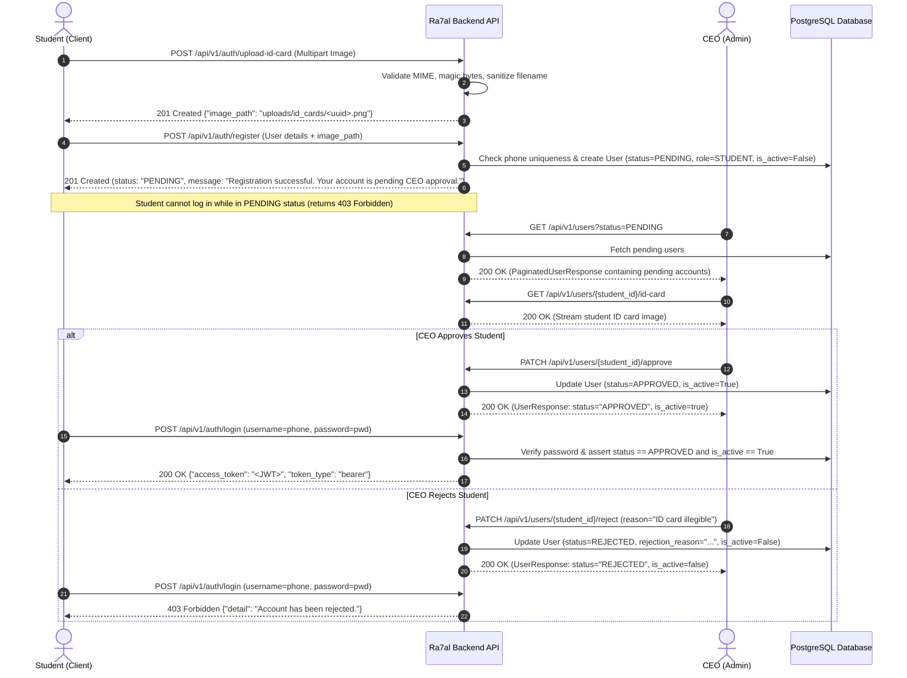

# Ra7al Backend API Documentation & Integration Specification

> **Version**: `0.1.0`  
> **Target Framework**: FastAPI / Python 3.12  
> **Specification Standard**: OpenAPI 3.1.0 (`docs/openapi.json`)  
> **Source of Truth**: Active codebase implementation  

---

## Table of Contents

1. [Architecture & Overview](#1-architecture--overview)
2. [Base URL & Environment Configuration](#2-base-url--environment-configuration)
3. [Authentication & Security Architecture](#3-authentication--security-architecture)
4. [Student Registration & CEO Approval Lifecycle](#4-student-registration--ceo-approval-lifecycle)
5. [Role-Based Access Control (RBAC) Matrix](#5-role-based-access-control-rbac-matrix)
6. [Global Error Structure & Response Standards](#6-global-error-structure--response-standards)
7. [Rate Limiting & Abuse Prevention](#7-rate-limiting--abuse-prevention)
8. [Complete API Endpoint Inventory](#8-complete-api-endpoint-inventory)
   - [8.1 Health & Diagnostics](#81-health--diagnostics)
   - [8.2 Authentication (`/api/v1/auth`)](#82-authentication-apiv1auth)
   - [8.3 User Management (`/api/v1/users`)](#83-user-management-apiv1users)
   - [8.4 Universities (`/api/v1/universities`)](#84-universities-apiv1universities)
   - [8.5 Fleet & Buses (`/api/v1/buses`)](#85-fleet--buses-apiv1buses)
   - [8.6 Stations (`/api/v1/stations`)](#86-stations-apiv1stations)
   - [8.7 Routes & Intermediate Stops (`/api/v1/routes`)](#87-routes--intermediate-stops-apiv1routes)
   - [8.8 Trips & Pickup Points (`/api/v1/trips`)](#88-trips--pickup-points-apiv1trips)
   - [8.9 Single-Trip Seat Reservations (`/api/v1/reservations`)](#89-single-trip-seat-reservations-apiv1reservations)
   - [8.10 Payments & Financial Verification (`/api/v1/payments`)](#810-payments--financial-verification-apiv1payments)
   - [8.11 Subscription Plans (`/api/v1/subscription-plans`)](#811-subscription-plans-apiv1subscription-plans)
   - [8.12 Route Transit Subscriptions (`/api/v1/subscriptions`)](#812-route-transit-subscriptions-apiv1subscriptions)
   - [8.13 Boarding Attendance & QR Scanning (`/api/v1/boarding`)](#813-boarding-attendance--qr-scanning-apiv1boarding)
9. [Frontend Developer Integration Guide](#9-frontend-developer-integration-guide)
10. [API Completeness Matrix](#10-api-completeness-matrix)

---

## 1. Architecture & Overview

The **Ra7al University Bus Management System** backend is an enterprise-grade RESTful service built with **FastAPI**, **SQLAlchemy ORM**, **Pydantic v2**, and **PostgreSQL**.

It provides core transportation management services:
- Student registration with university ID verification and CEO account approval.
- Role-based authorization across **Student**, **Supervisor**, and **CEO** user types.
- Fleet management (buses, stations, routes, intermediate stops, and gathering/pickup points).
- Scheduled trips with single-seat reservations and multi-ride period transit subscriptions (Daily, Monthly, Term).
- Digital and cash payment tracking with financial settlement workflows.
- QR-code based student boarding pass generation and supervisor validation with attendance auditing.

---

## 2. Base URL & Environment Configuration

### Path Prefixes
- **Primary API Version Prefix**: `/api/v1`
- **System Health Endpoints**: `/health` and `/health/db` (Root level)
- **Interactive Swagger UI**: `/docs`
- **Interactive ReDoc**: `/redoc`
- **OpenAPI 3.1.0 Contract**: `/openapi.json` (also stored statically in `docs/openapi.json`)

### Base URL
- **Local Development**: `http://localhost:<PORT>/api/v1` (Default local development port is `8000` or deployment-specific)
- **Production Base URL**: Configured per deployment environment via reverse proxy / load balancer.

> [!NOTE]
> All domain API routes (except the root health checks) are nested under the `/api/v1` prefix.

---

## 3. Authentication & Security Architecture

The backend implements stateless **JSON Web Token (JWT)** authentication using HMAC-SHA256 (`HS256`).

### 3.1 Token Mechanism & Lifecycle
- **Algorithm**: `HS256`
- **Access Token Expiration**: `30 minutes` (configurable via `ACCESS_TOKEN_EXPIRE_MINUTES`)
- **Password Hashing**: **Argon2** (`pwdlib.hashers.argon2.Argon2Hasher`) with minimum 8-character length requirement.
- **Refresh Tokens**: Not implemented on backend; re-authentication is performed via `POST /api/v1/auth/login`.

### 3.2 JWT Token Payload Structure
```json
{
  "sub": "42",
  "role": "STUDENT",
  "iat": 1772365200,
  "exp": 1772367000
}
```
- `sub`: The primary key user ID (integer serialized as string).
- `role`: The active user role string (`STUDENT`, `SUPERVISOR`, or `CEO`).
- `iat`: Epoch timestamp of token issuance (UTC).
- `exp`: Epoch timestamp of token expiration (UTC).

### 3.3 Sending Credentials
For all protected endpoints, the client must include the JWT token in the HTTP `Authorization` request header:
```http
Authorization: Bearer <ACCESS_TOKEN>
```

### 3.4 Invalid or Expired Token Behavior
When a token is missing, expired, signed with an invalid key, or refers to a nonexistent/inactive user, the API responds with **HTTP 401 Unauthorized**:
```json
{
  "detail": "Invalid or expired authentication token"
}
```

---

## 4. Student Registration & CEO Approval Lifecycle

Student accounts require administrative review and approval by the CEO before they are permitted to log in.

### 4.1 Lifecycle State Transitions

```
REGISTER
  ↓
PENDING
  ↓
CEO APPROVES
  ↓
APPROVED + STUDENT
  ↓
LOGIN
  ↓
JWT
```

And for rejected accounts:

```
PENDING
  ↓
CEO REJECTS
  ↓
REJECTED
  ↓
LOGIN DENIED
```

### 4.2 Registration & CEO Approval Flowchart



### 4.3 Security Rules for Registration & Approval
1. **E.164 Format**: Phone numbers are normalized strictly to E.164 (e.g., `+201012345678`).
2. **Default Inactive**: All new student registrations default to `status = PENDING`, `role = STUDENT`, and `is_active = false`.
3. **Login Denial**: Login requests for accounts in `PENDING` or `REJECTED` status or with `is_active = false` are blocked with HTTP 403 Forbidden.
4. **CEO Authority**: Only authenticated accounts with the `CEO` role may view pending users, approve accounts, reject accounts, or adjust user roles.
5. **Ownership Protection**: Students can only view/download their own uploaded university ID card; CEOs can inspect any student's ID card for verification.

---

## 5. Role-Based Access Control (RBAC) Matrix

The system recognizes three roles from `app.models.enums.RoleEnum`:
- **`STUDENT`**: University students registering, reserving seats, buying subscriptions, viewing boarding QR codes, submitting payments.
- **`SUPERVISOR`**: Trip supervisors viewing assigned routes/trips, passenger manifests, scanning student boarding QR passes.
- **`CEO`**: Full administrative system authority (fleet management, supervisor creation, plan creation, trip scheduling, financial verification, role elevation).

### 5.1 Endpoint Permission Matrix

| Module | HTTP Method & Path | Public | Student | Supervisor | CEO | Special Ownership Rules |
|:---|:---|:---:|:---:|:---:|:---:|:---|
| **Health** | `GET /health` | ✅ | ✅ | ✅ | ✅ | Open |
| **Health** | `GET /health/db` | ✅ | ✅ | ✅ | ✅ | Open |
| **Auth** | `POST /api/v1/auth/upload-id-card` | ✅ | ✅ | ✅ | ✅ | Rate limited (10/min) |
| **Auth** | `POST /api/v1/auth/register` | ✅ | ❌ | ❌ | ❌ | Unauthenticated public registration |
| **Auth** | `POST /api/v1/auth/login` | ✅ | ✅ | ✅ | ✅ | Public login |
| **Auth** | `GET /api/v1/auth/me` | ❌ | ✅ | ✅ | ✅ | Authenticated user |
| **Users** | `GET /api/v1/users` | ❌ | ❌ | ❌ | ✅ | CEO only (supports `?status=PENDING`) |
| **Users** | `GET /api/v1/users/pending` | ❌ | ❌ | ❌ | ✅ | CEO only (dedicated pending reviews list) |
| **Users** | `POST /api/v1/users/supervisors` | ❌ | ❌ | ❌ | ✅ | CEO only |
| **Users** | `GET /api/v1/users/{user_id}` | ❌ | ❌ | ❌ | ✅ | CEO only |
| **Users** | `GET /api/v1/users/{user_id}/id-card` | ❌ | 🔒 | ❌ | ✅ | Self (Owner) or CEO |
| **Users** | `PATCH /api/v1/users/{user_id}` | ❌ | ❌ | ❌ | ✅ | CEO only |
| **Users** | `PATCH /api/v1/users/{user_id}/role` | ❌ | ❌ | ❌ | ✅ | CEO only |
| **Users** | `PATCH /api/v1/users/{user_id}/status` | ❌ | ❌ | ❌ | ✅ | CEO only |
| **Users** | `PATCH /api/v1/users/{user_id}/approve` | ❌ | ❌ | ❌ | ✅ | CEO only |
| **Users** | `POST /api/v1/users/{user_id}/approve` | ❌ | ❌ | ❌ | ✅ | CEO only |
| **Users** | `PATCH /api/v1/users/{user_id}/reject` | ❌ | ❌ | ❌ | ✅ | CEO only |
| **Users** | `POST /api/v1/users/{user_id}/reject` | ❌ | ❌ | ❌ | ✅ | CEO only |
| **Universities** | `POST /api/v1/universities` | ❌ | ❌ | ❌ | ✅ | CEO only |
| **Universities** | `GET /api/v1/universities` | ✅ | ✅ | ✅ | ✅ | Public list for dropdowns |
| **Universities** | `GET /api/v1/universities/{id}` | ✅ | ✅ | ✅ | ✅ | Public lookup |
| **Universities** | `PATCH /api/v1/universities/{id}` | ❌ | ❌ | ❌ | ✅ | CEO only |
| **Universities** | `DELETE /api/v1/universities/{id}` | ❌ | ❌ | ❌ | ✅ | CEO only |
| **Buses** | `POST /api/v1/buses` | ❌ | ❌ | ❌ | ✅ | CEO only |
| **Buses** | `GET /api/v1/buses` | ❌ | ❌ | ✅ | ✅ | CEO or Supervisor |
| **Buses** | `GET /api/v1/buses/{id}` | ❌ | ❌ | ✅ | ✅ | CEO or Supervisor |
| **Buses** | `PATCH /api/v1/buses/{id}` | ❌ | ❌ | ❌ | ✅ | CEO only |
| **Buses** | `PATCH /api/v1/buses/{id}/status` | ❌ | ❌ | ❌ | ✅ | CEO only |
| **Buses** | `DELETE /api/v1/buses/{id}` | ❌ | ❌ | ❌ | ✅ | CEO only |
| **Stations** | `POST /api/v1/stations` | ❌ | ❌ | ✅ | ✅ | CEO or Supervisor |
| **Stations** | `GET /api/v1/stations` | ❌ | ❌ | ✅ | ✅ | CEO or Supervisor |
| **Stations** | `GET /api/v1/stations/{id}` | ❌ | ❌ | ✅ | ✅ | CEO or Supervisor |
| **Stations** | `PATCH /api/v1/stations/{id}` | ❌ | ❌ | ✅ | ✅ | CEO or Supervisor |
| **Stations** | `PATCH /api/v1/stations/{id}/status` | ❌ | ❌ | ✅ | ✅ | CEO or Supervisor |
| **Stations** | `DELETE /api/v1/stations/{id}` | ❌ | ❌ | ✅ | ✅ | CEO or Supervisor |
| **Routes** | `POST /api/v1/routes` | ❌ | ❌ | ✅ | ✅ | CEO or Supervisor |
| **Routes** | `GET /api/v1/routes` | ❌ | ❌ | ✅ | ✅ | CEO or Supervisor |
| **Routes** | `GET /api/v1/routes/{id}` | ❌ | ❌ | ✅ | ✅ | CEO or Supervisor |
| **Routes** | `PATCH /api/v1/routes/{id}` | ❌ | ❌ | ✅ | ✅ | CEO or Supervisor |
| **Routes** | `PATCH /api/v1/routes/{id}/status` | ❌ | ❌ | ✅ | ✅ | CEO or Supervisor |
| **Routes** | `PATCH /api/v1/routes/{id}/supervisor` | ❌ | ❌ | ✅ | ✅ | CEO or Supervisor |
| **Routes** | `DELETE /api/v1/routes/{id}` | ❌ | ❌ | ✅ | ✅ | CEO or Supervisor |
| **Routes** | `GET /api/v1/routes/{id}/stops` | ❌ | ❌ | ✅ | ✅ | CEO or Supervisor |
| **Routes** | `POST /api/v1/routes/{id}/stops` | ❌ | ❌ | ✅ | ✅ | CEO or Supervisor |
| **Routes** | `PATCH /api/v1/routes/{id}/stops/reorder` | ❌ | ❌ | ✅ | ✅ | CEO or Supervisor |
| **Routes** | `PATCH /api/v1/routes/{id}/stops/{stop_id}` | ❌ | ❌ | ✅ | ✅ | CEO or Supervisor |
| **Routes** | `DELETE /api/v1/routes/{id}/stops/{stop_id}` | ❌ | ❌ | ✅ | ✅ | CEO or Supervisor |
| **Trips** | `POST /api/v1/trips` | ❌ | ❌ | ❌ | ✅ | CEO only |
| **Trips** | `GET /api/v1/trips` | ❌ | ❌ | ✅ | ✅ | CEO or Supervisor |
| **Trips** | `GET /api/v1/trips/{id}` | ❌ | ❌ | ✅ | ✅ | CEO or Supervisor |
| **Trips** | `PATCH /api/v1/trips/{id}` | ❌ | ❌ | ❌ | ✅ | CEO only |
| **Trips** | `PATCH /api/v1/trips/{id}/status` | ❌ | ❌ | ❌ | ✅ | CEO only |
| **Trips** | `DELETE /api/v1/trips/{id}` | ❌ | ❌ | ❌ | ✅ | CEO only |
| **Trips** | `POST /api/v1/trips/{id}/pickup-points` | ❌ | ❌ | ❌ | ✅ | CEO only |
| **Trips** | `GET /api/v1/trips/{id}/pickup-points` | ❌ | ❌ | ✅ | ✅ | CEO or Supervisor |
| **Trips** | `PATCH /api/v1/trips/{id}/pickup-points/{pt_id}` | ❌ | ❌ | ❌ | ✅ | CEO only |
| **Trips** | `DELETE /api/v1/trips/{id}/pickup-points/{pt_id}` | ❌ | ❌ | ❌ | ✅ | CEO only |
| **Reservations** | `POST /api/v1/reservations` | ❌ | ✅ | ❌ | ❌ | Student only |
| **Reservations** | `GET /api/v1/reservations/available-trips` | ❌ | ✅ | ✅ | ✅ | Authenticated user |
| **Reservations** | `GET /api/v1/reservations/my` | ❌ | ✅ | ❌ | ❌ | Student only |
| **Reservations** | `GET /api/v1/reservations` | ❌ | ❌ | ✅ | ✅ | CEO or Supervisor |
| **Reservations** | `GET /api/v1/reservations/{id}` | ❌ | 🔒 | ✅ | ✅ | Student Owner or CEO/Supervisor |
| **Reservations** | `PATCH /api/v1/reservations/{id}/cancel` | ❌ | 🔒 | ✅ | ✅ | Student Owner or CEO/Supervisor |
| **Payments** | `POST /api/v1/payments` | ❌ | ✅ | ❌ | ❌ | Student only |
| **Payments** | `GET /api/v1/payments/my` | ❌ | ✅ | ❌ | ❌ | Student only |
| **Payments** | `GET /api/v1/payments` | ❌ | ❌ | ✅ | ✅ | CEO or Supervisor |
| **Payments** | `GET /api/v1/payments/{id}` | ❌ | 🔒 | ✅ | ✅ | Student Owner or CEO/Supervisor |
| **Payments** | `PATCH /api/v1/payments/{id}/submit` | ❌ | 🔒 | ❌ | ❌ | Student Owner only |
| **Payments** | `PATCH /api/v1/payments/{id}/cancel` | ❌ | 🔒 | ✅ | ✅ | Student Owner or CEO/Supervisor |
| **Payments** | `PATCH /api/v1/payments/{id}/verify` | ❌ | ❌ | ✅ | ✅ | CEO or Supervisor |
| **Payments** | `PATCH /api/v1/payments/{id}/reject` | ❌ | ❌ | ✅ | ✅ | CEO or Supervisor |
| **Subscription Plans** | `POST /api/v1/subscription-plans` | ❌ | ❌ | ❌ | ✅ | CEO only |
| **Subscription Plans** | `GET /api/v1/subscription-plans` | ❌ | ✅ | ✅ | ✅ | Authenticated (CEO sees all; others active) |
| **Subscription Plans** | `GET /api/v1/subscription-plans/{id}` | ✅ | ✅ | ✅ | ✅ | Public / Authenticated |
| **Subscription Plans** | `PATCH /api/v1/subscription-plans/{id}` | ❌ | ❌ | ❌ | ✅ | CEO only |
| **Subscription Plans** | `PATCH /api/v1/subscription-plans/{id}/status` | ❌ | ❌ | ❌ | ✅ | CEO only |
| **Subscriptions** | `GET /api/v1/subscriptions/plans` | ✅ | ✅ | ✅ | ✅ | Public / Student active plan listing |
| **Subscriptions** | `POST /api/v1/subscriptions` | ❌ | ✅ | ❌ | ❌ | Student only |
| **Subscriptions** | `GET /api/v1/subscriptions/my` | ❌ | ✅ | ❌ | ❌ | Student only |
| **Subscriptions** | `GET /api/v1/subscriptions` | ❌ | ❌ | ❌ | ✅ | CEO only |
| **Subscriptions** | `GET /api/v1/subscriptions/{id}` | ❌ | 🔒 | ✅ | ✅ | Student Owner or CEO/Supervisor |
| **Subscriptions** | `GET /api/v1/subscriptions/{id}/qr` | ❌ | 🔒 | ❌ | ✅ | Student Owner or CEO |
| **Subscriptions** | `GET /api/v1/subscriptions/{id}/history` | ❌ | 🔒 | ✅ | ✅ | Student Owner or CEO/Supervisor |
| **Subscriptions** | `PATCH /api/v1/subscriptions/{id}/cancel` | ❌ | 🔒 | ❌ | ✅ | Student Owner (if PENDING) or CEO |
| **Boarding** | `POST /api/v1/boarding/scan` | ❌ | ❌ | ✅ | ❌ | Supervisor only (Rate limited: 60/min) |
| **Boarding** | `GET /api/v1/boarding/trips/{id}/students` | ❌ | ❌ | 🔒 | ✅ | Assigned Supervisor or CEO |
| **Boarding** | `GET /api/v1/boarding/trips/{id}/records` | ❌ | ❌ | 🔒 | ✅ | Assigned Supervisor or CEO |
| **Boarding** | `GET /api/v1/boarding/records` | ❌ | ❌ | ❌ | ✅ | CEO only |

Legend:
- ✅ Allowed
- ❌ Denied / Forbidden
- 🔒 Allowed with Resource Ownership Constraint (e.g. Student must own the resource, or Supervisor must be assigned to the route/trip)

---

## 6. Global Error Structure & Response Standards

### 6.1 Standard Error Response Schema
For application-level errors, unauthorized attempts, and missing resources, the API returns a consistent JSON payload:

```json
{
  "detail": "Error explanation message"
}
```

### 6.2 Pydantic Validation Error Schema (HTTP 422)
When request bodies, headers, path parameters, or query parameters fail schema validation:

```json
{
  "detail": [
    {
      "loc": ["body", "phone_number"],
      "msg": "Invalid phone number format",
      "type": "value_error"
    }
  ]
}
```

### 6.3 HTTP Status Codes in Active Use

| Status Code | Meaning | Typical Occurrence |
|:---|:---|:---|
| **200 OK** | Success | GET requests, status updates, logins, approvals |
| **201 Created** | Resource Created | Registration, creating buses, trips, reservations, subscriptions, file uploads |
| **204 No Content** | Successful Deletion | DELETE endpoints (buses, universities, stations, routes, stops, trips, pickup points) |
| **400 Bad Request** | Malformed Input | Invalid request parameters |
| **401 Unauthorized** | Authentication Missing/Invalid | Missing/expired Bearer token, wrong credentials |
| **403 Forbidden** | RBAC / Pending Approval / Rejected | Role unauthorized, pending CEO approval, rejected account, inactive user |
| **404 Not Found** | Resource Missing | Entity ID does not exist in database |
| **409 Conflict** | State Conflict | Phone number already registered, duplicate vehicle or code |
| **422 Unprocessable** | Business Rule Violation | Invalid model field constraints, invalid state transition |
| **429 Too Many Requests** | Rate Limit Exceeded | Exceeded allowed requests in sliding window (`Retry-After` header returned) |
| **500 Server Error** | Internal Server Error | Uncaught server exception |
| **503 Service Unavailable**| Database Connection Failure| Database health check fails (`GET /health/db`) |

---

## 7. Rate Limiting & Abuse Prevention

Rate limiting is enforced at the route dependency layer using an atomic sliding-window algorithm backed by Memory or Redis (`app.core.rate_limiter`).

When a client is throttled, the API returns **HTTP 429 Too Many Requests** with a `Retry-After: <seconds>` header:
```json
{
  "detail": "Too many requests. Please try again later."
}
```

### Active Rate Limits

| Endpoint | Max Requests | Window (Seconds) | Purpose / Context |
|:---|:---:|:---:|:---|
| `POST /api/v1/auth/login` | 5 | 60 | Brute-force protection on credentials |
| `POST /api/v1/auth/register` | 5 | 60 | Registration flooding prevention |
| `POST /api/v1/auth/upload-id-card` | 10 | 60 | Disk and compute DoS prevention |
| `POST /api/v1/boarding/scan` | 60 | 60 | High-throughput supervisor scanning allowance |

---

## 8. Complete API Endpoint Inventory

---

### 8.1 Health & Diagnostics

#### `GET /health`
- **Operation ID**: `health_check_health_get`
- **Summary**: API health check
- **Auth**: Public
- **Response (200 OK)**:
```json
{
  "status": "ok"
}
```

#### `GET /health/db`
- **Operation ID**: `database_health_check_health_db_get`
- **Summary**: Database health check
- **Auth**: Public
- **Response (200 OK / 503 Service Unavailable)**:
```json
{
  "status": "ok",
  "database": "connected"
}
```

---

### 8.2 Authentication & Verification (`/api/v1/auth`)

#### `POST /api/v1/auth/upload-id-card`
- **Operation ID**: `upload_id_card_api_v1_auth_upload_id_card_post`
- **Summary**: Upload student university ID card image
- **Auth**: Public (Rate limit: 10/min)
- **Request (Multipart Form)**:
  - `file`: Image binary (Max 5MB; Allowed: `.jpg`, `.jpeg`, `.png`, `.webp`)
- **Response (201 Created)**:
```json
{
  "image_path": "uploads/id_cards/e6b22c2a04ec47189c4456910609f3e4.png"
}
```
- **Errors**: `422` (Invalid file type, dangerous double extension, executable payload, empty file).

#### `POST /api/v1/auth/register`
- **Operation ID**: `register_api_v1_auth_register_post`
- **Summary**: Register a new student account awaiting CEO approval
- **Auth**: Public (Rate limit: 5/min)
- **Request Body (`UserRegisterRequest`)**:
```json
{
  "full_name": "Ahmed Ali",
  "phone_number": "+201012345678",
  "password": "SecurePassword123!",
  "gender": "MALE",
  "university_id": 1,
  "faculty": "Faculty of Engineering",
  "academic_year": "3rd Year",
  "university_id_card_image": "uploads/id_cards/e6b22c2a04ec47189c4456910609f3e4.png"
}
```
- **Response (201 Created - `UserRegisterResponse`)**:
```json
{
  "id": 15,
  "full_name": "Ahmed Ali",
  "phone_number": "+201012345678",
  "gender": "MALE",
  "role": "STUDENT",
  "status": "PENDING",
  "rejection_reason": null,
  "is_active": false,
  "university_id": 1,
  "faculty": "Faculty of Engineering",
  "academic_year": "3rd Year",
  "university_id_card_image": "uploads/id_cards/e6b22c2a04ec47189c4456910609f3e4.png",
  "created_at": "2026-08-31T12:00:00Z",
  "updated_at": "2026-08-31T12:00:00Z",
  "message": "Registration submitted. Your account is pending CEO approval."
}
```
- **Errors**: `404` (University not found), `409` (Phone already registered), `422` (Validation error / Inactive university).

#### `POST /api/v1/auth/login`
- **Operation ID**: `login_api_v1_auth_login_post`
- **Summary**: Authenticate credentials and obtain JWT access token
- **Auth**: Public (Rate limit: 5/min)
- **Request (Form URL Encoded - OAuth2 Specification)**:
  - `username`: `+201012345678` (Registered E.164 phone number)
  - `password`: `SecurePassword123!`
- **Response (200 OK - `TokenResponse`)**:
```json
{
  "access_token": "eyJhbGciOiJIUzI1NiIsInR5cCI6IkpXVCJ9...",
  "token_type": "bearer"
}
```
- **Errors**: `401` (Incorrect phone number or password), `403` (Account is pending CEO approval, rejected, or inactive).

#### `GET /api/v1/auth/me`
- **Operation ID**: `get_me_api_v1_auth_me_get`
- **Summary**: Get current authenticated user profile
- **Auth**: Bearer JWT (Any active user)
- **Response (200 OK - `UserResponse`)**:
```json
{
  "id": 15,
  "full_name": "Ahmed Ali",
  "phone_number": "+201012345678",
  "gender": "MALE",
  "role": "STUDENT",
  "status": "APPROVED",
  "rejection_reason": null,
  "is_active": true,
  "university_id": 1,
  "faculty": "Faculty of Engineering",
  "academic_year": "3rd Year",
  "university_id_card_image": "uploads/id_cards/e6b22c2a04ec47189c4456910609f3e4.png",
  "created_at": "2026-08-31T12:00:00Z",
  "updated_at": "2026-08-31T12:00:00Z"
}
```

---

### 8.3 User Management (`/api/v1/users`)

#### `GET /api/v1/users`
- **Operation ID**: `list_users_api_v1_users_get`
- **Summary**: List all users with pagination and filters
- **Auth**: Bearer JWT (`CEO` only)
- **Query Parameters**:
  - `page`: `int` (default: 1, ge: 1)
  - `page_size`: `int` (default: 20, ge: 1, le: 100)
  - `role`: `RoleEnum` (optional: `STUDENT`, `SUPERVISOR`, `CEO`)
  - `is_active`: `bool` (optional)
  - `status`: `UserStatus` (optional: `PENDING`, `APPROVED`, `REJECTED`, `INACTIVE` — pass `status=PENDING` to list pending student registrations awaiting CEO review)
- **Response (200 OK - `PaginatedUserResponse`)**:
```json
{
  "items": [
    {
      "id": 1,
      "full_name": "System Administrator",
      "phone_number": "+201000000000",
      "gender": "MALE",
      "role": "CEO",
      "status": "APPROVED",
      "rejection_reason": null,
      "is_active": true,
      "university_id": null,
      "faculty": null,
      "academic_year": null,
      "university_id_card_image": null,
      "created_at": "2026-01-01T00:00:00Z",
      "updated_at": "2026-01-01T00:00:00Z"
    }
  ],
  "total": 1,
  "page": 1,
  "page_size": 20,
  "total_pages": 1
}
```

#### `GET /api/v1/users/pending`
- **Operation ID**: `list_pending_users_api_v1_users_pending_get`
- **Summary**: List pending users awaiting CEO approval (CEO only)
- **Auth**: Bearer JWT (`CEO` only)
- **Query Parameters**:
  - `page`: `int` (default: 1, ge: 1)
  - `page_size`: `int` (default: 20, ge: 1, le: 100)
- **Description**: Dedicated endpoint returning a paginated list of accounts with `status = PENDING` awaiting administrative approval.
- **Response (200 OK - `PaginatedUserResponse`)**:
```json
{
  "items": [
    {
      "id": 15,
      "full_name": "Ahmed Ali",
      "phone_number": "+201012345678",
      "gender": "MALE",
      "role": "STUDENT",
      "status": "PENDING",
      "rejection_reason": null,
      "is_active": false,
      "university_id": 1,
      "faculty": "Faculty of Engineering",
      "academic_year": "3rd Year",
      "university_id_card_image": "uploads/id_cards/e6b22c2a04ec47189c4456910609f3e4.png",
      "created_at": "2026-08-31T12:00:00Z",
      "updated_at": "2026-08-31T12:00:00Z"
    }
  ],
  "total": 1,
  "page": 1,
  "page_size": 20,
  "total_pages": 1
}
```
- **Errors**: `401` (Unauthorized), `403` (Forbidden if not CEO).

#### `POST /api/v1/users/supervisors`
- **Operation ID**: `create_supervisor_api_v1_users_supervisors_post`
- **Summary**: Create a supervisor account
- **Auth**: Bearer JWT (`CEO` only)
- **Request Body (`SupervisorCreateRequest`)**:
```json
{
  "full_name": "Sara Supervisor",
  "phone_number": "+201098765432",
  "password": "SuperSecretPassword123!",
  "gender": "FEMALE"
}
```
- **Response (201 Created - `UserResponse`)**:
```json
{
  "id": 20,
  "full_name": "Sara Supervisor",
  "phone_number": "+201098765432",
  "gender": "FEMALE",
  "role": "SUPERVISOR",
  "status": "APPROVED",
  "rejection_reason": null,
  "is_active": true,
  "university_id": null,
  "faculty": null,
  "academic_year": null,
  "university_id_card_image": null,
  "created_at": "2026-08-31T12:00:00Z",
  "updated_at": "2026-08-31T12:00:00Z"
}
```

#### `GET /api/v1/users/{user_id}`
- **Operation ID**: `get_user_by_id_api_v1_users__user_id__get`
- **Summary**: Get user details by ID
- **Auth**: Bearer JWT (`CEO` only)
- **Response (200 OK - `UserResponse`)**

#### `GET /api/v1/users/{user_id}/id-card`
- **Operation ID**: `get_user_id_card_api_v1_users__user_id__id_card_get`
- **Summary**: Download/view student ID card image
- **Auth**: Bearer JWT (Student Owner of `user_id` or `CEO`)
- **Response (200 OK)**: Raw binary file stream with `X-Content-Type-Options: nosniff`.
- **Errors**: `403` (Forbidden if not owner or CEO), `404` (ID card not uploaded / user not found).

#### `PATCH /api/v1/users/{user_id}`
- **Operation ID**: `update_user_api_v1_users__user_id__patch`
- **Summary**: Update user details
- **Auth**: Bearer JWT (`CEO` only)
- **Request Body (`UserUpdateRequest`)**:
```json
{
  "full_name": "Updated Name",
  "faculty": "Faculty of Science",
  "academic_year": "4th Year"
}
```
- **Response (200 OK - `UserResponse`)**

#### `PATCH /api/v1/users/{user_id}/role`
- **Operation ID**: `update_user_role_api_v1_users__user_id__role_patch`
- **Summary**: Update user role (CEO only)
- **Auth**: Bearer JWT (`CEO` only)
- **Request Body (`UserRoleUpdateRequest`)**:
```json
{
  "role": "SUPERVISOR"
}
```
- **Response (200 OK - `UserResponse`)**

#### `PATCH /api/v1/users/{user_id}/status`
- **Operation ID**: `update_user_status_api_v1_users__user_id__status_patch`
- **Summary**: Activate or deactivate a user account (CEO only)
- **Auth**: Bearer JWT (`CEO` only)
- **Request Body (`UserStatusUpdateRequest`)**:
```json
{
  "is_active": false
}
```
- **Response (200 OK - `UserResponse`)**

#### `PATCH /api/v1/users/{user_id}/approve` & `POST /api/v1/users/{user_id}/approve`
- **Operation ID**: `approve_user_api_v1_users__user_id__approve_patch` / `approve_user_api_v1_users__user_id__approve_post`
- **Summary**: Approve a pending student account (CEO only)
- **Auth**: Bearer JWT (`CEO` only)
- **Path Parameters**:
  - `user_id`: `int` (The user ID of the pending student)
- **Description**: Transitions account lifecycle status from `PENDING` to `APPROVED`, sets `is_active` to `true`, and clears any previous rejection reason. After approval, the student is permitted to log in via `/api/v1/auth/login`.
- **Response (200 OK - `UserResponse`)**:
```json
{
  "id": 15,
  "full_name": "Ahmed Ali",
  "phone_number": "+201012345678",
  "gender": "MALE",
  "role": "STUDENT",
  "status": "APPROVED",
  "rejection_reason": null,
  "is_active": true,
  "university_id": 1,
  "faculty": "Faculty of Engineering",
  "academic_year": "3rd Year",
  "university_id_card_image": "uploads/id_cards/e6b22c2a04ec47189c4456910609f3e4.png",
  "created_at": "2026-08-31T12:00:00Z",
  "updated_at": "2026-08-31T12:30:00Z"
}
```
- **Errors**: `403` (Non-CEO or self-approval attempt), `404` (User not found), `422` (Cannot approve an already rejected account).

#### `PATCH /api/v1/users/{user_id}/reject` & `POST /api/v1/users/{user_id}/reject`
- **Operation ID**: `reject_user_api_v1_users__user_id__reject_patch` / `reject_user_api_v1_users__user_id__reject_post`
- **Summary**: Reject a pending student account (CEO only)
- **Auth**: Bearer JWT (`CEO` only)
- **Path Parameters**:
  - `user_id`: `int` (The user ID of the pending student)
- **Request Body (`UserRejectRequest` - Optional)**:
```json
{
  "reason": "University ID card image is blurred and illegible."
}
```
- **Description**: Transitions account lifecycle status from `PENDING` to `REJECTED`, sets `is_active` to `false`, and records the optional rejection reason. Login attempts by rejected users will be blocked with HTTP 403 Forbidden.
- **Response (200 OK - `UserResponse`)**:
```json
{
  "id": 15,
  "full_name": "Ahmed Ali",
  "phone_number": "+201012345678",
  "gender": "MALE",
  "role": "STUDENT",
  "status": "REJECTED",
  "rejection_reason": "University ID card image is blurred and illegible.",
  "is_active": false,
  "university_id": 1,
  "faculty": "Faculty of Engineering",
  "academic_year": "3rd Year",
  "university_id_card_image": "uploads/id_cards/e6b22c2a04ec47189c4456910609f3e4.png",
  "created_at": "2026-08-31T12:00:00Z",
  "updated_at": "2026-08-31T12:35:00Z"
}
```
- **Errors**: `403` (Non-CEO or self-rejection attempt), `404` (User not found), `422` (Cannot reject an already approved account).

---

### 8.4 Universities (`/api/v1/universities`)

#### `POST /api/v1/universities`
- **Operation ID**: `create_university_api_v1_universities_post`
- **Summary**: Create a new university
- **Auth**: Bearer JWT (`CEO` only)
- **Request Body (`UniversityCreateRequest`)**: `{"name": "Cairo University"}`
- **Response (201 Created - `UniversityResponse`)**:
```json
{
  "id": 1,
  "name": "Cairo University",
  "is_active": true,
  "created_at": "2026-08-31T12:00:00Z",
  "updated_at": "2026-08-31T12:00:00Z"
}
```

#### `GET /api/v1/universities`
- **Operation ID**: `list_universities_api_v1_universities_get`
- **Summary**: List universities with pagination and filters
- **Auth**: Public / Authenticated
- **Query Parameters**: `page`, `page_size`, `is_active`, `search`
- **Response (200 OK - `PaginatedUniversityResponse`)**

#### `GET /api/v1/universities/{university_id}`
- **Operation ID**: `get_university_by_id_api_v1_universities__university_id__get`
- **Summary**: Get university details by ID
- **Auth**: Public / Authenticated
- **Response (200 OK - `UniversityResponse`)**

#### `PATCH /api/v1/universities/{university_id}`
- **Operation ID**: `update_university_api_v1_universities__university_id__patch`
- **Summary**: Update university details
- **Auth**: Bearer JWT (`CEO` only)
- **Request Body (`UniversityUpdateRequest`)**: `{"name": "Ain Shams University", "is_active": true}`
- **Response (200 OK - `UniversityResponse`)**

#### `DELETE /api/v1/universities/{university_id}`
- **Operation ID**: `delete_university_api_v1_universities__university_id__delete`
- **Summary**: Delete a university
- **Auth**: Bearer JWT (`CEO` only)
- **Response (204 No Content)**
- **Errors**: `409` (Cannot delete university if referenced by registered students).

---

### 8.5 Fleet & Buses (`/api/v1/buses`)

#### `POST /api/v1/buses`
- **Operation ID**: `create_bus_api_v1_buses_post`
- **Summary**: Create a new bus in the fleet
- **Auth**: Bearer JWT (`CEO` only)
- **Request Body (`BusCreateRequest`)**:
```json
{
  "bus_number": "BUS-101",
  "license_plate": "ABC-1234",
  "capacity": 50,
  "model": "Mercedes-Benz Travego",
  "year": 2023
}
```
- **Response (201 Created - `BusResponse`)**:
```json
{
  "id": 1,
  "bus_number": "BUS-101",
  "license_plate": "ABC-1234",
  "capacity": 50,
  "model": "Mercedes-Benz Travego",
  "year": 2023,
  "status": "ACTIVE",
  "created_at": "2026-08-31T12:00:00Z",
  "updated_at": "2026-08-31T12:00:00Z"
}
```

#### `GET /api/v1/buses`
- **Operation ID**: `list_buses_api_v1_buses_get`
- **Summary**: List all buses
- **Auth**: Bearer JWT (`CEO` or `SUPERVISOR`)
- **Query Parameters**: `page`, `page_size`, `status` (`ACTIVE`, `INACTIVE`, `MAINTENANCE`), `search`
- **Response (200 OK - `PaginatedBusResponse`)**

#### `GET /api/v1/buses/{bus_id}`
- **Operation ID**: `get_bus_by_id_api_v1_buses__bus_id__get`
- **Summary**: Get bus details by ID
- **Auth**: Bearer JWT (`CEO` or `SUPERVISOR`)
- **Response (200 OK - `BusResponse`)**

#### `PATCH /api/v1/buses/{bus_id}`
- **Operation ID**: `update_bus_api_v1_buses__bus_id__patch`
- **Summary**: Update bus details
- **Auth**: Bearer JWT (`CEO` only)
- **Request Body (`BusUpdateRequest`)**: `{"capacity": 45, "model": "Volvo 9700"}`
- **Response (200 OK - `BusResponse`)**

#### `PATCH /api/v1/buses/{bus_id}/status`
- **Operation ID**: `update_bus_status_api_v1_buses__bus_id__status_patch`
- **Summary**: Update bus operational status
- **Auth**: Bearer JWT (`CEO` only)
- **Request Body (`BusStatusUpdateRequest`)**: `{"status": "MAINTENANCE"}`
- **Response (200 OK - `BusResponse`)**

#### `DELETE /api/v1/buses/{bus_id}`
- **Operation ID**: `delete_bus_api_v1_buses__bus_id__delete`
- **Summary**: Delete a bus from the fleet
- **Auth**: Bearer JWT (`CEO` only)
- **Response (204 No Content)**

---

### 8.6 Stations (`/api/v1/stations`)

> [!NOTE]
> All endpoints in the Stations router require **`CEO`** or **`SUPERVISOR`** role.

#### `POST /api/v1/stations`
- **Operation ID**: `create_station_api_v1_stations_post`
- **Summary**: Create a new bus station/stop
- **Auth**: Bearer JWT (`CEO` or `SUPERVISOR`)
- **Request Body (`StationCreateRequest`)**:
```json
{
  "name": "Main Campus Gate",
  "code": "ST-CAMPUS-01",
  "address": "123 University Avenue, Cairo",
  "latitude": 30.0444,
  "longitude": 31.2357
}
```
- **Response (201 Created - `StationResponse`)**:
```json
{
  "id": 1,
  "name": "Main Campus Gate",
  "code": "ST-CAMPUS-01",
  "address": "123 University Avenue, Cairo",
  "latitude": 30.0444,
  "longitude": 31.2357,
  "is_active": true,
  "created_at": "2026-08-31T12:00:00Z",
  "updated_at": "2026-08-31T12:00:00Z"
}
```

#### `GET /api/v1/stations`
- **Operation ID**: `list_stations_api_v1_stations_get`
- **Summary**: List all stations with pagination and search
- **Auth**: Bearer JWT (`CEO` or `SUPERVISOR`)
- **Query Parameters**: `page`, `page_size`, `is_active`, `search`
- **Response (200 OK - `PaginatedStationResponse`)**

#### `GET /api/v1/stations/{station_id}`
- **Operation ID**: `get_station_by_id_api_v1_stations__station_id__get`
- **Summary**: Get station details by ID
- **Auth**: Bearer JWT (`CEO` or `SUPERVISOR`)
- **Response (200 OK - `StationResponse`)**

#### `PATCH /api/v1/stations/{station_id}`
- **Operation ID**: `update_station_api_v1_stations__station_id__patch`
- **Summary**: Update station details
- **Auth**: Bearer JWT (`CEO` or `SUPERVISOR`)
- **Request Body (`StationUpdateRequest`)**: `{"name": "North Gate Station"}`
- **Response (200 OK - `StationResponse`)**

#### `PATCH /api/v1/stations/{station_id}/status`
- **Operation ID**: `update_station_status_api_v1_stations__station_id__status_patch`
- **Summary**: Activate or deactivate a station
- **Auth**: Bearer JWT (`CEO` or `SUPERVISOR`)
- **Request Body (`StationStatusUpdateRequest`)**: `{"is_active": false}`
- **Response (200 OK - `StationResponse`)**

#### `DELETE /api/v1/stations/{station_id}`
- **Operation ID**: `delete_station_api_v1_stations__station_id__delete`
- **Summary**: Delete a station
- **Auth**: Bearer JWT (`CEO` or `SUPERVISOR`)
- **Response (204 No Content)**
- **Errors**: `409` (Cannot delete station in use by routes or stops).

---

### 8.7 Routes & Intermediate Stops (`/api/v1/routes`)

> [!NOTE]
> All endpoints in the Routes router require **`CEO`** or **`SUPERVISOR`** role.

#### `POST /api/v1/routes`
- **Operation ID**: `create_route_api_v1_routes_post`
- **Summary**: Create a new bus route
- **Auth**: Bearer JWT (`CEO` or `SUPERVISOR`)
- **Request Body (`RouteCreateRequest`)**:
```json
{
  "route_number": "R-101",
  "name": "Campus Express",
  "origin_station_id": 1,
  "destination_station_id": 2,
  "distance_km": 15.5,
  "estimated_duration_minutes": 35,
  "supervisor_id": 3
}
```
- **Response (201 Created - `RouteResponse`)**

#### `GET /api/v1/routes`
- **Operation ID**: `list_routes_api_v1_routes_get`
- **Summary**: List all routes with pagination and filters
- **Auth**: Bearer JWT (`CEO` or `SUPERVISOR`)
- **Query Parameters**: `page`, `page_size`, `is_active`, `supervisor_id`, `search`
- **Response (200 OK - `PaginatedRouteResponse`)**

#### `GET /api/v1/routes/{route_id}`
- **Operation ID**: `get_route_by_id_api_v1_routes__route_id__get`
- **Summary**: Get route details by ID (including origin, destination, and ordered stops)
- **Auth**: Bearer JWT (`CEO` or `SUPERVISOR`)
- **Response (200 OK - `RouteResponse`)**

#### `PATCH /api/v1/routes/{route_id}`
- **Operation ID**: `update_route_api_v1_routes__route_id__patch`
- **Summary**: Update route metadata
- **Auth**: Bearer JWT (`CEO` or `SUPERVISOR`)
- **Request Body (`RouteUpdateRequest`)**: `{"distance_km": 18.0}`
- **Response (200 OK - `RouteResponse`)**

#### `PATCH /api/v1/routes/{route_id}/status`
- **Operation ID**: `update_route_status_api_v1_routes__route_id__status_patch`
- **Summary**: Update route active status
- **Auth**: Bearer JWT (`CEO` or `SUPERVISOR`)
- **Request Body (`RouteStatusUpdateRequest`)**: `{"is_active": true}`
- **Response (200 OK - `RouteResponse`)**

#### `PATCH /api/v1/routes/{route_id}/supervisor`
- **Operation ID**: `assign_supervisor_api_v1_routes__route_id__supervisor_patch`
- **Summary**: Assign or reassign supervisor to route
- **Auth**: Bearer JWT (`CEO` or `SUPERVISOR`)
- **Request Body (`RouteSupervisorUpdateRequest`)**: `{"supervisor_id": 5}` (pass `null` to unassign)
- **Response (200 OK - `RouteResponse`)**

#### `DELETE /api/v1/routes/{route_id}`
- **Operation ID**: `delete_route_api_v1_routes__route_id__delete`
- **Summary**: Delete a route (cascades intermediate stops)
- **Auth**: Bearer JWT (`CEO` or `SUPERVISOR`)
- **Response (204 No Content)**

#### `GET /api/v1/routes/{route_id}/stops`
- **Operation ID**: `get_route_stops_api_v1_routes__route_id__stops_get`
- **Summary**: List ordered intermediate stops for a route
- **Auth**: Bearer JWT (`CEO` or `SUPERVISOR`)
- **Response (200 OK - `list[RouteStopResponse]`)**

#### `POST /api/v1/routes/{route_id}/stops`
- **Operation ID**: `add_route_stop_api_v1_routes__route_id__stops_post`
- **Summary**: Add an intermediate stop to a route
- **Auth**: Bearer JWT (`CEO` or `SUPERVISOR`)
- **Request Body (`RouteStopCreateRequest`)**: `{"station_id": 4, "stop_order": 2}`
- **Response (201 Created - `RouteStopResponse`)**

#### `PATCH /api/v1/routes/{route_id}/stops/reorder`
- **Operation ID**: `reorder_route_stops_api_v1_routes__route_id__stops_reorder_patch`
- **Summary**: Batch reorder stops on a route
- **Auth**: Bearer JWT (`CEO` or `SUPERVISOR`)
- **Request Body (`RouteStopReorderRequest`)**:
```json
{
  "stops": [
    {"route_stop_id": 1, "stop_order": 1},
    {"route_stop_id": 2, "stop_order": 2}
  ]
}
```
- **Response (200 OK - `list[RouteStopResponse]`)**

#### `PATCH /api/v1/routes/{route_id}/stops/{route_stop_id}`
- **Operation ID**: `update_route_stop_api_v1_routes__route_id__stops__route_stop_id__patch`
- **Summary**: Update single route stop sequence
- **Auth**: Bearer JWT (`CEO` or `SUPERVISOR`)
- **Request Body (`RouteStopUpdateRequest`)**: `{"stop_order": 3}`
- **Response (200 OK - `RouteStopResponse`)**

#### `DELETE /api/v1/routes/{route_id}/stops/{route_stop_id}`
- **Operation ID**: `remove_route_stop_api_v1_routes__route_id__stops__route_stop_id__delete`
- **Summary**: Remove an intermediate stop from a route
- **Auth**: Bearer JWT (`CEO` or `SUPERVISOR`)
- **Response (204 No Content)**

---

### 8.8 Trips & Pickup Points (`/api/v1/trips`)

#### `POST /api/v1/trips`
- **Operation ID**: `create_trip_api_v1_trips_post`
- **Summary**: Schedule a new trip
- **Auth**: Bearer JWT (`CEO` only)
- **Request Body (`TripCreateRequest`)**:
```json
{
  "route_id": 1,
  "bus_id": 2,
  "supervisor_id": 3,
  "departure_time": "2026-09-01T07:30:00Z",
  "estimated_arrival_time": "2026-09-01T08:15:00Z",
  "passenger_capacity": 50,
  "fare_amount": 50.00,
  "pickup_points": [
    {"name": "Main Gate", "address": "Gate 1", "sequence": 1},
    {"name": "Square 2", "address": "Downtown", "sequence": 2}
  ]
}
```
- **Response (201 Created - `TripResponse`)**

#### `GET /api/v1/trips`
- **Operation ID**: `list_trips_api_v1_trips_get`
- **Summary**: List scheduled trips with pagination and multi-field filters
- **Auth**: Bearer JWT (`CEO` or `SUPERVISOR`)
- **Query Parameters**: `page`, `page_size`, `status` (`SCHEDULED`, `IN_PROGRESS`, `COMPLETED`, `CANCELLED`), `route_id`, `bus_id`, `supervisor_id`, `departure_after`, `departure_before`
- **Response (200 OK - `PaginatedTripResponse`)**

#### `GET /api/v1/trips/{trip_id}`
- **Operation ID**: `get_trip_by_id_api_v1_trips__trip_id__get`
- **Summary**: Get trip details by ID
- **Auth**: Bearer JWT (`CEO` or `SUPERVISOR`)
- **Response (200 OK - `TripResponse`)**

#### `PATCH /api/v1/trips/{trip_id}`
- **Operation ID**: `update_trip_api_v1_trips__trip_id__patch`
- **Summary**: Update trip schedule, bus, supervisor, or capacity
- **Auth**: Bearer JWT (`CEO` only)
- **Request Body (`TripUpdateRequest`)**: `{"bus_id": 4, "fare_amount": 55.00}`
- **Response (200 OK - `TripResponse`)**

#### `PATCH /api/v1/trips/{trip_id}/status`
- **Operation ID**: `update_trip_status_api_v1_trips__trip_id__status_patch`
- **Summary**: Transition trip operational status
- **Auth**: Bearer JWT (`CEO` only)
- **Request Body (`TripStatusUpdateRequest`)**: `{"status": "IN_PROGRESS"}`
- **Response (200 OK - `TripResponse`)**

#### `DELETE /api/v1/trips/{trip_id}`
- **Operation ID**: `delete_trip_api_v1_trips__trip_id__delete`
- **Summary**: Delete a scheduled trip
- **Auth**: Bearer JWT (`CEO` only)
- **Response (204 No Content)**

#### `POST /api/v1/trips/{trip_id}/pickup-points`
- **Operation ID**: `add_pickup_point_api_v1_trips__trip_id__pickup_points_post`
- **Summary**: Add a pickup point to a trip
- **Auth**: Bearer JWT (`CEO` only)
- **Request Body (`PickupPointCreateRequest`)**: `{"name": "Square A", "address": "Main Ave", "sequence": 1}`
- **Response (201 Created - `PickupPointResponse`)**

#### `GET /api/v1/trips/{trip_id}/pickup-points`
- **Operation ID**: `list_pickup_points_api_v1_trips__trip_id__pickup_points_get`
- **Summary**: List all pickup points for a trip
- **Auth**: Bearer JWT (`CEO` or `SUPERVISOR`)
- **Response (200 OK - `list[PickupPointResponse]`)**

#### `PATCH /api/v1/trips/{trip_id}/pickup-points/{point_id}`
- **Operation ID**: `update_pickup_point_api_v1_trips__trip_id__pickup_points__point_id__patch`
- **Summary**: Update a pickup point
- **Auth**: Bearer JWT (`CEO` only)
- **Request Body (`PickupPointUpdateRequest`)**: `{"name": "Square A (Updated)", "sequence": 1}`
- **Response (200 OK - `PickupPointResponse`)**

#### `DELETE /api/v1/trips/{trip_id}/pickup-points/{point_id}`
- **Operation ID**: `delete_pickup_point_api_v1_trips__trip_id__pickup_points__point_id__delete`
- **Summary**: Delete a pickup point from a trip
- **Auth**: Bearer JWT (`CEO` only)
- **Response (204 No Content)**

---

### 8.9 Single-Trip Seat Reservations (`/api/v1/reservations`)

#### `POST /api/v1/reservations`
- **Operation ID**: `book_trip_api_v1_reservations_post`
- **Summary**: Book a seat on a scheduled trip
- **Auth**: Bearer JWT (`STUDENT` only)
- **Request Body (`ReservationCreateRequest`)**:
```json
{
  "trip_id": 1
}
```
- **Response (201 Created - `ReservationResponse`)**:
```json
{
  "id": 10,
  "trip_id": 1,
  "student_id": 15,
  "status": "CONFIRMED",
  "booked_at": "2026-08-31T12:00:00Z",
  "cancelled_at": null,
  "created_at": "2026-08-31T12:00:00Z",
  "updated_at": "2026-08-31T12:00:00Z"
}
```
- **Errors**: `404` (Trip not found), `409` (Already booked / Capacity fully booked), `422` (Trip not in scheduled status).

#### `GET /api/v1/reservations/available-trips`
- **Operation ID**: `list_available_trips_api_v1_reservations_available_trips_get`
- **Summary**: List scheduled trips available for booking
- **Auth**: Bearer JWT (Any authenticated user)
- **Query Parameters**: `page`, `page_size`, `route_id`
- **Response (200 OK - `PaginatedAvailableTripResponse`)**:
```json
{
  "items": [
    {
      "id": 1,
      "route_id": 1,
      "bus_id": 2,
      "supervisor_id": 3,
      "departure_time": "2026-09-01T07:30:00Z",
      "estimated_arrival_time": "2026-09-01T08:15:00Z",
      "status": "SCHEDULED",
      "passenger_capacity": 50,
      "confirmed_reservations_count": 12,
      "available_seats": 38,
      "fare_amount": 50.00,
      "created_at": "2026-08-31T12:00:00Z",
      "updated_at": "2026-08-31T12:00:00Z",
      "route": { "...": "RouteResponse" },
      "bus": { "...": "BusResponse" },
      "pickup_points": [
        {
          "id": 1,
          "trip_id": 1,
          "name": "Cairo University Gate 3",
          "address": "Giza, University St.",
          "sequence": 1,
          "created_at": "2026-08-31T12:00:00Z",
          "updated_at": "2026-08-31T12:00:00Z"
        }
      ]
    }
  ],
  "total": 1,
  "page": 1,
  "page_size": 20,
  "total_pages": 1
}
```

#### `GET /api/v1/reservations/my`
- **Operation ID**: `list_my_reservations_api_v1_reservations_my_get`
- **Summary**: List authenticated student's own reservations
- **Auth**: Bearer JWT (`STUDENT` only)
- **Query Parameters**: `page`, `page_size`, `status` (`CONFIRMED`, `CANCELLED`), `trip_id`
- **Response (200 OK - `PaginatedReservationResponse`)**

#### `GET /api/v1/reservations`
- **Operation ID**: `list_admin_reservations_api_v1_reservations_get`
- **Summary**: List all reservations with filters (Admin view)
- **Auth**: Bearer JWT (`CEO` or `SUPERVISOR`)
- **Query Parameters**: `page`, `page_size`, `trip_id`, `student_id`, `status`, `booked_after`, `booked_before`
- **Response (200 OK - `PaginatedReservationResponse`)**

#### `GET /api/v1/reservations/{reservation_id}`
- **Operation ID**: `get_reservation_by_id_api_v1_reservations__reservation_id__get`
- **Summary**: Get reservation details by ID
- **Auth**: Bearer JWT (Student Owner or `CEO`/`SUPERVISOR`)
- **Response (200 OK - `ReservationResponse`)**

#### `PATCH /api/v1/reservations/{reservation_id}/cancel`
- **Operation ID**: `cancel_reservation_api_v1_reservations__reservation_id__cancel_patch`
- **Summary**: Cancel a reservation and release seat
- **Auth**: Bearer JWT (Student Owner or `CEO`/`SUPERVISOR`)
- **Response (200 OK - `ReservationResponse`)**

---

### 8.10 Payments & Financial Verification (`/api/v1/payments`)

#### `POST /api/v1/payments`
- **Operation ID**: `create_payment_api_v1_payments_post`
- **Summary**: Create a payment attempt for a reservation
- **Auth**: Bearer JWT (`STUDENT` only)
- **Request Body (`PaymentCreateRequest`)**:
```json
{
  "reservation_id": 10,
  "method": "VODAFONE_CASH",
  "transaction_reference": "VC-987654321",
  "notes": "Transferred from wallet 01012345678"
}
```
- **Response (201 Created - `PaymentResponse`)**:
```json
{
  "id": 5,
  "reservation_id": 10,
  "subscription_id": null,
  "student_id": 15,
  "amount": 50.00,
  "currency": "EGP",
  "method": "VODAFONE_CASH",
  "status": "PENDING",
  "transaction_reference": "VC-987654321",
  "notes": "Transferred from wallet 01012345678",
  "paid_at": null,
  "verified_at": null,
  "verified_by": null,
  "created_at": "2026-08-31T12:00:00Z",
  "updated_at": "2026-08-31T12:00:00Z"
}
```

#### `GET /api/v1/payments/my`
- **Operation ID**: `list_my_payments_api_v1_payments_my_get`
- **Summary**: List student's own payments
- **Auth**: Bearer JWT (`STUDENT` only)
- **Query Parameters**: `page`, `page_size`, `status` (`PENDING`, `SUBMITTED`, `VERIFIED`, `REJECTED`, `CANCELLED`), `method` (`VODAFONE_CASH`, `INSTAPAY`, `CASH`), `reservation_id`
- **Response (200 OK - `PaginatedPaymentResponse`)**

#### `GET /api/v1/payments`
- **Operation ID**: `list_admin_payments_api_v1_payments_get`
- **Summary**: List all payments system-wide
- **Auth**: Bearer JWT (`CEO` or `SUPERVISOR`)
- **Query Parameters**: `page`, `page_size`, `reservation_id`, `student_id`, `method`, `status`, `created_after`, `created_before`
- **Response (200 OK - `PaginatedPaymentResponse`)**

#### `GET /api/v1/payments/{payment_id}`
- **Operation ID**: `get_payment_by_id_api_v1_payments__payment_id__get`
- **Summary**: Get payment details by ID
- **Auth**: Bearer JWT (Student Owner or `CEO`/`SUPERVISOR`)
- **Response (200 OK - `PaymentResponse`)**

#### `PATCH /api/v1/payments/{payment_id}/submit`
- **Operation ID**: `submit_payment_api_v1_payments__payment_id__submit_patch`
- **Summary**: Submit payment proof / transaction reference
- **Auth**: Bearer JWT (Student Owner only)
- **Request Body (`PaymentSubmitRequest`)**:
```json
{
  "transaction_reference": "IP-123456789",
  "notes": "InstaPay transfer confirmation attached"
}
```
- **Response (200 OK - `PaymentResponse` with status `SUBMITTED`)**

#### `PATCH /api/v1/payments/{payment_id}/cancel`
- **Operation ID**: `cancel_payment_api_v1_payments__payment_id__cancel_patch`
- **Summary**: Cancel an unsettled payment attempt
- **Auth**: Bearer JWT (Student Owner or `CEO`/`SUPERVISOR`)
- **Response (200 OK - `PaymentResponse` with status `CANCELLED`)**

#### `PATCH /api/v1/payments/{payment_id}/verify`
- **Operation ID**: `verify_payment_api_v1_payments__payment_id__verify_patch`
- **Summary**: Administratively verify payment receipt
- **Auth**: Bearer JWT (`CEO` or `SUPERVISOR`)
- **Response (200 OK - `PaymentResponse` with status `VERIFIED`, `verified_at`, `verified_by`)**

#### `PATCH /api/v1/payments/{payment_id}/reject`
- **Operation ID**: `reject_payment_api_v1_payments__payment_id__reject_patch`
- **Summary**: Administratively reject payment
- **Auth**: Bearer JWT (`CEO` or `SUPERVISOR`)
- **Request Body (`PaymentRejectRequest`)**:
```json
{
  "rejection_reason": "Transfer reference not received in bank statement"
}
```
- **Response (200 OK - `PaymentResponse` with status `REJECTED`)**

---

### 8.11 Subscription Plans (`/api/v1/subscription-plans`)

#### `POST /api/v1/subscription-plans`
- **Operation ID**: `create_subscription_plan_api_v1_subscription_plans_post`
- **Summary**: Create a new subscription plan
- **Auth**: Bearer JWT (`CEO` only)
- **Request Body (`SubscriptionPlanCreate`)**:
```json
{
  "name": "Monthly Commuter Plan",
  "plan_type": "MONTHLY",
  "price": 1200.00,
  "currency": "EGP",
  "duration_days": 30
}
```
- **Response (201 Created - `SubscriptionPlanResponse`)**:
```json
{
  "id": 1,
  "name": "Monthly Commuter Plan",
  "plan_type": "MONTHLY",
  "duration_days": 30,
  "price": 1200.00,
  "currency": "EGP",
  "is_active": true,
  "created_at": "2026-08-31T12:00:00Z",
  "updated_at": "2026-08-31T12:00:00Z"
}
```

#### `GET /api/v1/subscription-plans`
- **Operation ID**: `list_subscription_plans_api_v1_subscription_plans_get`
- **Summary**: List subscription plans (CEO sees all; others see active only)
- **Auth**: Bearer JWT (Any authenticated user)
- **Query Parameters**: `page`, `page_size`, `is_active` (CEO only)
- **Response (200 OK - `PaginatedSubscriptionPlanResponse`)**

#### `GET /api/v1/subscription-plans/{plan_id}`
- **Operation ID**: `get_subscription_plan_by_id_api_v1_subscription_plans__plan_id__get`
- **Summary**: Get subscription plan details by ID
- **Auth**: Public / Authenticated
- **Response (200 OK - `SubscriptionPlanResponse`)**

#### `PATCH /api/v1/subscription-plans/{plan_id}`
- **Operation ID**: `update_subscription_plan_api_v1_subscription_plans__plan_id__patch`
- **Summary**: Update subscription plan details
- **Auth**: Bearer JWT (`CEO` only)
- **Request Body (`SubscriptionPlanUpdate`)**: `{"name": "Updated Monthly Plan", "price": 1250.00}`
- **Response (200 OK - `SubscriptionPlanResponse`)**

#### `PATCH /api/v1/subscription-plans/{plan_id}/status`
- **Operation ID**: `update_subscription_plan_status_api_v1_subscription_plans__plan_id__status_patch`
- **Summary**: Activate or deactivate a subscription plan
- **Auth**: Bearer JWT (`CEO` only)
- **Request Body (`SubscriptionPlanStatusUpdate`)**: `{"is_active": false}`
- **Response (200 OK - `SubscriptionPlanResponse`)**

---

### 8.12 Route Transit Subscriptions (`/api/v1/subscriptions`)

#### `GET /api/v1/subscriptions/plans`
- **Operation ID**: `list_available_subscription_plans_api_v1_subscriptions_plans_get`
- **Summary**: List active subscription plans for students
- **Auth**: Public / Authenticated
- **Response (200 OK - `list[SubscriptionPlanResponse]`)**

#### `POST /api/v1/subscriptions`
- **Operation ID**: `create_subscription_api_v1_subscriptions_post`
- **Summary**: Purchase a new route transit subscription
- **Auth**: Bearer JWT (`STUDENT` only)
- **Request Body (`SubscriptionCreateRequest`)**:
```json
{
  "route_id": 1,
  "plan_id": 1,
  "start_date": "2026-09-01",
  "outbound_pickup_point_id": 1,
  "return_pickup_mode": "SAME_AS_OUTBOUND",
  "return_pickup_point_id": null,
  "payment_method": "VODAFONE_CASH",
  "transaction_reference": "VC-11223344"
}
```
- **Response (201 Created - `SubscriptionResponse`)**:
```json
{
  "id": 8,
  "student_id": 15,
  "route_id": 1,
  "plan_id": 1,
  "price_snapshot": 1200.00,
  "currency": "EGP",
  "start_date": "2026-09-01",
  "end_date": "2026-09-30",
  "outbound_pickup_point_id": 1,
  "return_pickup_point_id": 1,
  "return_pickup_mode": "SAME_AS_OUTBOUND",
  "payment_id": 12,
  "status": "PENDING",
  "created_at": "2026-08-31T12:00:00Z",
  "updated_at": "2026-08-31T12:00:00Z"
}
```

#### `GET /api/v1/subscriptions/my`
- **Operation ID**: `list_my_subscriptions_api_v1_subscriptions_my_get`
- **Summary**: List student's own subscriptions with ride stats
- **Auth**: Bearer JWT (`STUDENT` only)
- **Query Parameters**: `page`, `page_size`, `status` (`PENDING`, `ACTIVE`, `EXPIRED`, `CANCELLED`), `route_id`
- **Response (200 OK - `PaginatedSubscriptionResponse`)**

#### `GET /api/v1/subscriptions`
- **Operation ID**: `list_all_subscriptions_api_v1_subscriptions_get`
- **Summary**: List all subscriptions system-wide (Admin view)
- **Auth**: Bearer JWT (`CEO` only)
- **Query Parameters**: `page`, `page_size`, `student_id`, `university_id`, `route_id`, `plan_type`, `status`, `start_date_from`, `start_date_to`, `end_date_from`, `end_date_to`
- **Response (200 OK - `PaginatedSubscriptionResponse`)**

#### `GET /api/v1/subscriptions/{subscription_id}`
- **Operation ID**: `get_subscription_by_id_api_v1_subscriptions__subscription_id__get`
- **Summary**: Get subscription details with boarding statistics
- **Auth**: Bearer JWT (Student Owner or `CEO`/`SUPERVISOR`)
- **Response (200 OK - `SubscriptionDetailResponse`)**

#### `GET /api/v1/subscriptions/{subscription_id}/qr`
- **Operation ID**: `get_subscription_qr_api_v1_subscriptions__subscription_id__qr_get`
- **Summary**: Get active subscription QR token credential
- **Auth**: Bearer JWT (Student Owner or `CEO`)
- **Response (200 OK - `SubscriptionQRResponse`)**:
```json
{
  "subscription_id": 8,
  "plan_type": "MONTHLY",
  "route_id": 1,
  "route_name": "Campus Express",
  "valid_from": "2026-09-01",
  "valid_until": "2026-09-30",
  "qr_payload": "eyJyYWd...signed_qr_payload...",
  "status": "ACTIVE"
}
```

#### `GET /api/v1/subscriptions/{subscription_id}/history`
- **Operation ID**: `get_subscription_boarding_history_api_v1_subscriptions__subscription_id__history_get`
- **Summary**: Get subscription boarding ride history
- **Auth**: Bearer JWT (Student Owner or `CEO`/`SUPERVISOR`)
- **Query Parameters**: `page`, `page_size`
- **Response (200 OK - `list[SubscriptionBoardingHistoryItem]`)**

#### `PATCH /api/v1/subscriptions/{subscription_id}/cancel`
- **Operation ID**: `cancel_subscription_api_v1_subscriptions__subscription_id__cancel_patch`
- **Summary**: Cancel a subscription (Student owner for PENDING status, or CEO anytime)
- **Auth**: Bearer JWT (Student Owner if `PENDING` or `CEO`)
- **Response (200 OK - `SubscriptionResponse`)**

---

### 8.13 Boarding Attendance & QR Scanning (`/api/v1/boarding`)

#### `POST /api/v1/boarding/scan`
- **Operation ID**: `scan_boarding_api_v1_boarding_scan_post`
- **Summary**: Validate QR token and record student boarding event
- **Auth**: Bearer JWT (`SUPERVISOR` only, Rate limit: 60/min)
- **Request Body (`BoardingScanRequest`)**:
```json
{
  "qr_token": "eyJyYWd...signed_qr_payload...",
  "trip_id": 1,
  "direction": "OUTBOUND",
  "pickup_point_id": 1
}
```
- **Response (200 OK - `BoardingResponse`)**:
```json
{
  "success": true,
  "message": "Boarding verified successfully",
  "student": {
    "id": 15,
    "full_name": "Ahmed Ali",
    "phone_number": "+201012345678",
    "faculty": "Faculty of Engineering",
    "academic_year": "3rd Year"
  },
  "subscription_id": 8,
  "plan_type": "MONTHLY",
  "route_id": 1,
  "direction": "OUTBOUND",
  "pickup_point_id": 1,
  "boarded_at": "2026-09-01T07:35:12Z"
}
```
- **Errors**: `403` (Supervisor not assigned to trip), `422` (Invalid QR token, expired subscription, unpaid subscription, wrong route, student already boarded this direction today).

#### `GET /api/v1/boarding/trips/{trip_id}/students`
- **Operation ID**: `get_trip_students_api_v1_boarding_trips__trip_id__students_get`
- **Summary**: List subscribed students for a scheduled trip with per-trip boarding status
- **Auth**: Bearer JWT (Assigned `SUPERVISOR` or `CEO`)
- **Response (200 OK - `list[SupervisorTripStudentResponse]`)**:
```json
[
  {
    "student_id": 15,
    "student_name": "Ahmed Ali",
    "subscription_id": 8,
    "subscription_type": "MONTHLY",
    "subscription_status": "ACTIVE",
    "start_date": "2026-09-01",
    "end_date": "2026-09-30",
    "payment_status": "VERIFIED",
    "outbound_pickup": "Main Gate",
    "return_pickup": "Main Gate",
    "boarding_count": 4,
    "outbound_boarding_count": 2,
    "return_boarding_count": 2,
    "outbound_boarded": true,
    "return_boarded": false,
    "last_boarded_at": "2026-09-01T07:35:12Z"
  }
]
```

#### `GET /api/v1/boarding/trips/{trip_id}/records`
- **Operation ID**: `get_trip_boarding_records_api_v1_boarding_trips__trip_id__records_get`
- **Summary**: List recorded boarding events for a trip
- **Auth**: Bearer JWT (Assigned `SUPERVISOR` or `CEO`)
- **Response (200 OK - `list[BoardingRecordResponse]`)**

#### `GET /api/v1/boarding/records`
- **Operation ID**: `list_all_boarding_records_api_v1_boarding_records_get`
- **Summary**: List system-wide boarding event records
- **Auth**: Bearer JWT (`CEO` only)
- **Query Parameters**: `page`, `page_size`, `trip_id`, `student_id`, `supervisor_id`, `subscription_id`, `direction`, `boarded_after`, `boarded_before`
- **Response (200 OK - `PaginatedBoardingRecordResponse`)**

---

## 9. Frontend Developer Integration Guide

### 9.1 Authentication & Axios / Fetch Interceptors Setup

#### Axios Interceptor Example
```javascript
import axios from 'axios';

const api = axios.create({
  baseURL: process.env.REACT_APP_API_BASE_URL || 'http://localhost:8000/api/v1',
  headers: {
    'Content-Type': 'application/json',
  },
});

// Request Interceptor: Attach JWT Bearer Token
api.interceptors.request.use((config) => {
  const token = localStorage.getItem('access_token');
  if (token) {
    config.headers.Authorization = `Bearer ${token}`;
  }
  return config;
});

// Response Interceptor: Handle Global Errors
api.interceptors.response.use(
  (response) => response,
  (error) => {
    if (error.response) {
      const status = error.response.status;
      const data = error.response.data;

      if (status === 401) {
        // Token expired or invalid
        localStorage.removeItem('access_token');
        window.location.href = '/login?expired=true';
      } else if (status === 403) {
        alert('Access denied: You do not have permission for this action.');
      } else if (status === 429) {
        const retryAfter = error.response.headers['retry-after'] || '60';
        alert(`Rate limit exceeded. Please wait ${retryAfter} seconds before trying again.`);
      }
    }
    return Promise.reject(error);
  }
);

export default api;
```

### 9.2 Step-by-Step Student Registration & CEO Approval Flow

1. **Upload University ID Card**:
   ```javascript
   const formData = new FormData();
   formData.append('file', fileInput.files[0]);

   const { data: uploadRes } = await api.post('/auth/upload-id-card', formData, {
     headers: { 'Content-Type': 'multipart/form-data' }
   });
   const imagePath = uploadRes.image_path; // e.g. "uploads/id_cards/uuid.png"
   ```

2. **Submit Registration Details**:
   ```javascript
   const { data: userRes } = await api.post('/auth/register', {
     full_name: fullName,
     phone_number: phoneNumber, // E.164 e.g. "+201012345678"
     password: password,
     gender: "MALE",
     university_id: parseInt(universityId),
     faculty: facultyName,
     academic_year: "3rd Year",
     university_id_card_image: imagePath
   });
   // userRes.status is "PENDING", is_active is false
   // User must wait for CEO review and approval before login is permitted.
   ```

3. **CEO Review & Approval (Administrative)**:
   ```javascript
   // 1. CEO lists pending user registrations:
   const { data: pendingUsers } = await api.get('/users?status=PENDING');

   // 2. CEO approves the student:
   await api.patch(`/users/${studentId}/approve`);
   // Account status is now "APPROVED", is_active is true.
   // (If rejecting: await api.patch(`/users/${studentId}/reject`, { reason: "ID blurred" });)
   ```

4. **Login & Store Token**:
   ```javascript
   // Form URL-encoded format required by OAuth2 endpoint
   const params = new URLSearchParams();
   params.append('username', phoneNumber); // Phone number is the username
   params.append('password', password);

   const { data: loginRes } = await api.post('/auth/login', params, {
     headers: { 'Content-Type': 'application/x-www-form-urlencoded' }
   });

   localStorage.setItem('access_token', loginRes.access_token);
   ```

5. **Fetch Current User & Role**:
   ```javascript
   const { data: profile } = await api.get('/auth/me');
   console.log('User Role:', profile.role); // "STUDENT", "SUPERVISOR", "CEO"
   console.log('User Status:', profile.status); // "APPROVED"
   ```

### 9.3 Handling Validation Errors (HTTP 422)
When form submission fails, map the FastAPI detail array to form error state:
```javascript
function extractFormErrors(errorResponse) {
  if (errorResponse && Array.isArray(errorResponse.detail)) {
    const fieldErrors = {};
    errorResponse.detail.forEach((err) => {
      const fieldName = err.loc[err.loc.length - 1];
      fieldErrors[fieldName] = err.msg;
    });
    return fieldErrors;
  }
  return { general: errorResponse?.detail || 'An unexpected error occurred' };
}
```

---

## 10. API Completeness Matrix

| Domain | Implemented | Documented | OpenAPI Contract | Automated Tests | Notes |
|:---|:---:|:---:|:---:|:---:|:---|
| **Health Checks** | YES | YES | YES | YES | `/health`, `/health/db` |
| **Authentication & Tokens** | YES | YES | YES | YES | Login, Me, Token generation/decoding |
| **User Approval & Admin** | YES | YES | YES | YES | Registration (PENDING), CEO Approval/Rejection, Supervisor creation, Role & Status management |
| **User & Supervisor Admin** | YES | YES | YES | YES | List, Create supervisor, Role, Status, ID card view |
| **Universities** | YES | YES | YES | YES | Full CRUD |
| **Fleet & Buses** | YES | YES | YES | YES | Full CRUD + Status management |
| **Stations** | YES | YES | YES | YES | Full CRUD + Active status |
| **Routes & Stops** | YES | YES | YES | YES | Full CRUD + Sequential stop ordering & reorder |
| **Trips & Pickup Points** | YES | YES | YES | YES | Scheduling, Lifecycle transitions, Gathering points |
| **Seat Reservations** | YES | YES | YES | YES | Booking, Available trip capacity calculation, My reservations, Admin list, Cancel |
| **Payments** | YES | YES | YES | YES | Multi-method (Vodafone Cash, InstaPay, Cash), Submit proof, Verify, Reject, Cancel |
| **Subscription Plans** | YES | YES | YES | YES | Daily, Monthly, Term plans CRUD + Status |
| **Route Subscriptions** | YES | YES | YES | YES | Student purchase, QR credential export, Ride history, CEO list, Cancellation |
| **Boarding & Attendance** | YES | YES | YES | YES | QR scanning, Direction verification, Duplicate boarding prevention, Trip manifests |
| **CEO Dedicated Dashboard** | PARTIAL | YES | YES | YES | Handled via domain listing endpoints (`/users`, `/subscriptions`, `/boarding/records`, `/payments`, `/trips`); standalone `/dashboard` aggregation endpoint not currently implemented. |

---
*Documentation generated from live backend source inspection and verified against OpenAPI 3.1.0 contract.*
