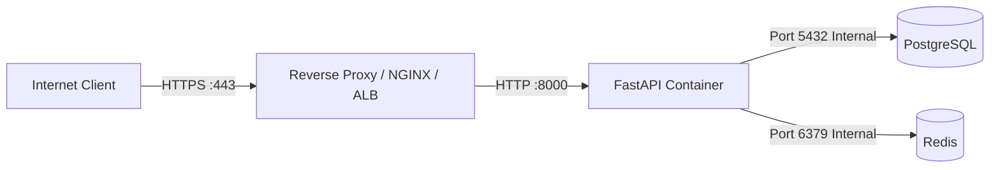

# Ra7al Production Deployment Security Guide

## 1. Required Environment Variables

All production environment variables must be injected at runtime through a dedicated secret manager (e.g., AWS Secrets Manager, HashiCorp Vault, Azure Key Vault).

| Variable Name | Required Type | Description | Production Security Constraint |
| :--- | :--- | :--- | :--- |
| `APP_ENV` | `string` | Environment name | Must be set to `production`. |
| `DEBUG` | `boolean` | Debug mode | Must be set to `false`. |
| `LOG_LEVEL` | `string` | Logging verbosity | `INFO` or `WARNING`. |
| `DATABASE_URL` | `string` | PostgreSQL connection URL | Must use non-default strong credentials; no `postgres:postgres` or `localhost`. |
| `JWT_SECRET_KEY` | `string` | Cryptographic secret for signing JWTs | Must be at least 32 random characters (64+ recommended). |
| `JWT_ALGORITHM` | `string` | JWT signing algorithm | `HS256` (default). |
| `ACCESS_TOKEN_EXPIRE_MINUTES`| `integer` | Token expiration | `30` minutes. |
| `RATE_LIMIT_ENABLED` | `boolean` | Enable rate limiting | `true`. |
| `RATE_LIMIT_BACKEND` | `string` | Rate limiter store | `redis`. |
| `TRUSTED_PROXIES` | `string` | Comma-separated trusted reverse proxy IPs | e.g. `10.0.0.1,172.16.0.0/12,127.0.0.1`. |
| `CORS_ORIGINS` | `string` | Allowed web origins | Comma-separated explicit domains; **no wildcard (`*`)**. |

---

## 2. Secret Injection & Secret Manager Architecture

1. **No Secrets in Source Code or Docker Images:**
   * Never commit `.env` files.
   * Never hardcode secrets in `Dockerfile` or `docker-compose.prod.yml`.
2. **Container Secret Injection:**
   * Inject secrets as container environment variables or mounted files via orchestration tools (e.g., Kubernetes Secrets, AWS ECS Secrets, Docker Swarm Secrets).

---

## 3. Secret Rotation Procedures

### A. JWT Secret Key Rotation
To rotate `JWT_SECRET_KEY` without logging out active users:
1. Maintain support for dual-key validation during the transition window:
   * Tokens are decoded using either the current key or the previous key.
   * New tokens are issued exclusively using the new primary key.
2. After the token lifetime window expires (e.g., 30 minutes), deprecate and remove the old key.

### B. Database Password Rotation
1. Create a secondary database user with the new password in PostgreSQL:
   ```sql
   CREATE USER ra7al_prod_v2 WITH PASSWORD 'NewCryptographicallySecurePassword2026!';
   GRANT ALL PRIVILEGES ON DATABASE bus_system TO ra7al_prod_v2;
   ```
2. Update the secret manager with the new `DATABASE_URL` referencing `ra7al_prod_v2`.
3. Perform a rolling restart of API instances.
4. Once all connections migrate, revoke and drop the previous user.

---

## 4. Reverse Proxy & Network Architecture



* **TLS Termination:** The reverse proxy terminates TLS (TLS 1.2+ only, strong ciphers).
* **Header Forwarding:** The reverse proxy must overwrite `X-Forwarded-For` and `X-Real-IP` with the client's genuine remote address.
* **Internal Network Isolation:** Only the API port (8000) or Reverse Proxy (443) is reachable from the public internet. PostgreSQL and Redis have no published host ports.
