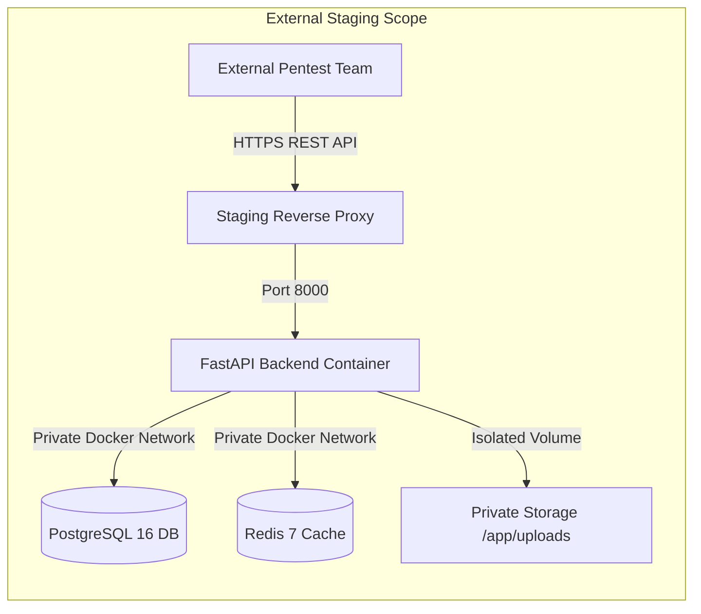
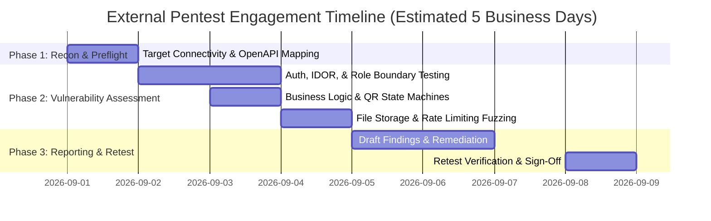

# Independent External Penetration Testing Plan

**Project:** Ra7al University Bus Management System  
**Document ID:** SEC-PENTEST-EXT-PLAN-2026-V1  
**Target Environment:** Staging Container & Staging API (`https://staging-api.ra7al.edu` / `http://localhost:8000`)  
**Assessment Standard:** OWASP Top 10 API Security (2023), OWASP ASVS v4.0.3, NIST SP 800-115  
**Internal Staging Pentest Status:** **PASS (61/61 Scenarios Blocked)**  
**Independent External Pentest Status:** **NOT PERFORMED (Ready for Third-Party Engagement)**  
**Production Release Gate:** **BLOCKED (AMBER — Internal Validation Complete, External Pentest Pending)**  

---

## 1. Plan Purpose & Scope

This document provides external, accredited penetration testing teams with the operational plan, testing timeline, technical architecture, credential matrix, and evaluation criteria required to conduct an independent security assessment of the **Ra7al University Bus Management System**.

### Primary Assessment Objectives:
1. Identify any exploitable vulnerabilities in API authentication, authorization, or business logic.
2. Validate horizontal (IDOR) and vertical (privilege escalation) access control boundaries across Students, Supervisors, and Administrators.
3. Assess the resilience of bus boarding workflows against QR code tampering, replay attacks, and concurrency race conditions.
4. Verify private storage isolation for student ID cards and prevent unauthorized data exfiltration.
5. Provide actionable finding sheets with step-by-step reproduction and CVSS v3.1 scoring.

---

## 2. Assessment Architecture & Target Infrastructure

* **Staging Host / Endpoint:** `https://staging-api.ra7al.edu` (or container exposed at `http://localhost:8000`)
* **OpenAPI Documentation:** `GET /docs`, `GET /redoc`, `GET /openapi.json`
* **API Route Inventory:** 58 distinct paths / 83 endpoint operations cataloged.

---

## 3. Engagement Personas & Provisioned Accounts

External testers will be provisioned with standard non-production credentials across all role personas:

| Persona | Role Identifier | Primary Function | Boundary Constraint Under Test |
| :--- | :--- | :--- | :--- |
| **Anonymous** | Unauthenticated | Public registration & OpenAPI probing | Must receive 401 on all protected endpoints |
| **Student A** | `student_a@ra7al.edu.eg` | Active Route 1 subscription & payments | Cannot access Student B data; cannot scan boarding |
| **Student B** | `student_b@ra7al.edu.eg` | Active Route 2 subscription & payments | Cannot exfiltrate Student A QR or cancel payments |
| **Supervisor A** | `supervisor_a@ra7al.edu.eg`| Trip 1 supervisor & boarding scanner | Cannot scan Trip 2; cannot view other manifests |
| **Supervisor B** | `supervisor_b@ra7al.edu.eg`| Trip 2 supervisor & boarding scanner | Cannot scan Trip 1; cannot alter financial records |
| **CEO Admin** | `ceo@ra7al.edu.eg` | System administrator & fee settlement | Cannot perform bus boarding scan (contained) |
| **Suspended Student** | `disabled_student@ra7al.edu.eg`| Deactivated student account | Immediate revocation on all endpoints (401) |

---

## 4. Methodological Phases & Engagement Timeline

1. **Phase 1: Reconnaissance & Environment Verification (Day 1):**
   * Validate API health, staging connectivity, and OpenAPI spec.
   * Run automated preflight script (`scripts/security/external_pentest_preflight.py`) to confirm baseline environment health.
2. **Phase 2: Adversarial Threat Simulation (Days 2–4):**
   * Execute manual and automated black-box tests following `docs/EXTERNAL_PENTEST_TEST_MATRIX.md`.
   * Simulate complex multi-step attack chains, parameter tampering, and high-concurrency races.
3. **Phase 3: Reporting & Developer Remediation (Days 5–7):**
   * Submit draft vulnerability report using `docs/EXTERNAL_PENTEST_REPORT_TEMPLATE.md`.
   * Ra7al engineering implements patches and adds regression test coverage under `tests/security/`.
4. **Phase 4: Retest & Final Production Sign-Off (Day 8):**
   * External tester re-executes tests against patched staging deployment.
   * Upon zero open Critical/High findings, external lead issues certified sign-off.

---

## 5. Emergency Halt & Rules of Engagement Notice

* All testing must comply strictly with `docs/EXTERNAL_PENTEST_RULES_OF_ENGAGEMENT.md`.
* In the event of Remote Code Execution (RCE), full database exfiltration, or unauthenticated PII leakage, pause immediately and alert `appsec@ra7al.edu.eg` within 1 hour.
