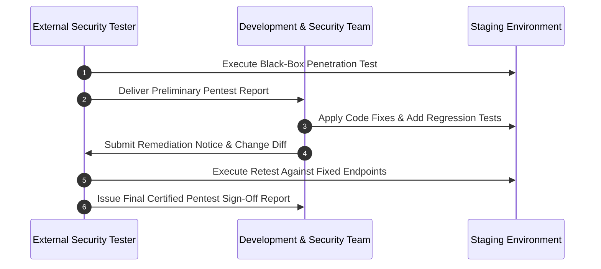

# External Penetration Testing Rules of Engagement (RoE)

**Project:** Ra7al University Bus Management System  
**Document ID:** SEC-PENTEST-ROE-2026-V1  
**Target Environment:** Staging API (`https://staging-api.ra7al.edu` / `http://localhost:8000`)  
**Status:** AUTHORIZED ENGAGEMENT FRAMEWORK  
**Independent Pentest Execution Status:** **INDEPENDENT EXTERNAL PENTEST: NOT PERFORMED**  

---

## 1. Authorization & Authority to Test

This Rules of Engagement (RoE) document governs all independent security assessments conducted by accredited external security testing organizations against the **Ra7al University Bus Management System**.

Authorization is granted under the following explicit constraints:
1. All activities must strictly target the designated **Staging** infrastructure.
2. Production systems, live university database records, and active student devices are **strictly prohibited** from testing.
3. No denial-of-service, physical, or social engineering attacks may be performed.

---

## 2. Communication Protocol & Emergency Escalation

### Primary Contacts

| Role | Name / Title | Contact Email | Emergency Phone |
| :--- | :--- | :--- | :--- |
| **CISO / Security Lead** | Ra7al AppSec Team | `appsec@ra7al.edu.eg` | `+20-100-111-2222` |
| **DevSecOps Lead** | Lead Systems Engineer | `devsecops@ra7al.edu.eg` | `+20-100-333-4444` |
| **Incident Response Desk** | 24/7 SecOps Desk | `soc@ra7al.edu.eg` | `+20-100-555-6666` |

### Immediate Halt & Critical Escalation Triggers

Testing must immediately PAUSE and the emergency contacts must be notified within **1 hour** upon discovery of:
* Remote Code Execution (RCE) on backend container hosts.
* Unauthenticated SQL Injection enabling full database exfiltration or deletion.
* Mass Student Personally Identifiable Information (PII) leakage without authentication.
* Hardcoded production master secrets discovered in staging responses.

---

## 3. Severity Classification & Scoring Matrix

Findings must be classified using the **Common Vulnerability Scoring System (CVSS v3.1)** and categorized according to the **OWASP Top 10 API Security** and **CWE**:

| Severity | CVSS v3.1 Base Range | Definition & SLA for Remediation |
| :--- | :--- | :--- |
| **CRITICAL** | `9.0 – 10.0` | Remote compromise, full unauthenticated database access, administrative authentication bypass. Remediation SLA: **24 hours**. |
| **HIGH** | `7.0 – 8.9` | Cross-student IDOR, payment bypass, student ID card exfiltration, file upload executable execution. Remediation SLA: **72 hours**. |
| **MEDIUM** | `4.0 – 6.9` | Rate limiting bypass, information disclosure, verbose error stacktraces, CSRF where applicable. Remediation SLA: **7 days**. |
| **LOW** | `0.1 – 3.9` | Missing non-critical defense-in-depth headers, minor parameter anomalies, legacy schema residue. Remediation SLA: **14 days**. |
| **INFORMATIONAL** | `0.0` | Best practice recommendations, hardening observations without direct exploitability. |

---

## 4. Retest & Verification Lifecycle

1. **Phase 1: Initial Assessment:** External firm executes adversarial scenarios, black-box testing, and business-logic validation against staging.
2. **Phase 2: Draft Finding Delivery:** External firm delivers initial findings with full reproduction steps and evidence.
3. **Phase 3: Remediation & Regression Test Development:** Engineering team implements fixes and adds unit/integration regression tests under `tests/security/`.
4. **Phase 4: Independent Retest:** External firm re-executes tests against patched staging deployment.
5. **Phase 5: Final Production Security Sign-Off:** Upon zero open Critical/High findings and verified retest, the Production Security Gate may transition from `BLOCKED` to `GREEN`.
