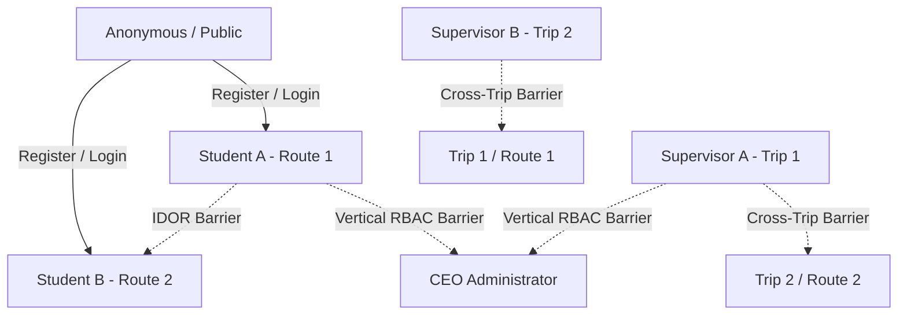

# External Penetration Testing Scope & Technical Specification

**Project:** Ra7al University Bus Management System  
**Document ID:** SEC-PENTEST-SCOPE-2026-V1  
**Assessment Type:** Independent Third-Party External Black-Box Penetration Test  
**Status:** READY FOR THIRD-PARTY ENGAGEMENT  
**Current Execution Status:** **INDEPENDENT EXTERNAL PENTEST: NOT PERFORMED**  

---

## 1. Engagement Objective

This document defines the technical scope, test targets, asset boundaries, role personas, and data handling requirements for an independent third-party penetration testing firm evaluating the **Ra7al University Bus Management System** backend and API infrastructure.

The goal is to simulate realistic, unprivileged, authenticated, and hostile threat actors attempting to compromise student privacy, exfiltrate Personally Identifiable Information (PII), forge financial payments, bypass boarding controls, perform privilege escalation, or breach infrastructure confidentiality.

---

## 2. In-Scope Targets & Systems

Testing is authorized strictly against the designated Staging environment:

| Scope Category | Target Component / URL | Notes |
| :--- | :--- | :--- |
| **API Base URL** | `https://staging-api.ra7al.edu` (or `http://localhost:8000` for staging container) | REST API on FastAPI 0.115+ |
| **API Documentation** | `GET /docs`, `GET /redoc`, `GET /openapi.json` | OpenAPI 3.1.0 specification |
| **Authentication Services** | `POST /api/v1/auth/*` | Registration, login, profile, ID card upload |
| **Student Subscriptions** | `GET/POST/PATCH /api/v1/subscriptions/*` | Plans, lifecycle, QR retrieval |
| **Boarding & Scanning** | `POST /api/v1/boarding/scan`, `/api/v1/boarding/trips/*` | Supervisor QR verification |
| **Financial Settlements** | `GET/POST/PATCH /api/v1/payments/*` | Vodafone Cash, InstaPay, Cash |
| **Transit Operations** | `GET/POST/PATCH/DELETE /api/v1/trips/*`, `/routes/*`, `/buses/*`, `/stations/*` | Operational RBAC |
| **User Management** | `GET/PATCH /api/v1/users/*` | Role management, student ID card downloads |
| **Health Probes** | `GET /health`, `GET /health/db` | Liveness and readiness endpoints |

---

## 3. Out-of-Scope Systems & Prohibited Actions

The following systems and actions are strictly excluded from the penetration test:

> [!CAUTION]
> **Strictly Out-of-Scope:**
> 1. **Production Infrastructure:** Any system, database, or domain outside the designated staging environment (`*.ra7al.edu` production endpoints).
> 2. **Physical Attacks:** Attacks on physical university buses, terminal devices, or campus offices.
> 3. **Social Engineering / Phishing:** Phishing campus staff, students, or bus supervisors.
> 4. **Denial-of-Service (DoS / DDoS):** Volumetric network flooding, SYN floods, or resource exhaustion aimed at degrading staging infrastructure availability.
> 5. **Destructive Data Deletion:** Arbitrary drops of underlying database schemas or destruction of container volumes.

---

## 4. Test Personas & Role Boundaries

External testers will be provisioned with standard non-production credentials across all application roles to validate cross-tenant and vertical boundaries:

### Role Matrix & Expected Permissions

| Role Persona | Target Identifier | Permitted Operations | Prohibited Operations (Must Return 403) |
| :--- | :--- | :--- | :--- |
| **Anonymous** | Unauthenticated | View OpenAPI spec, register student, log in, health probe | Any authenticated endpoint (`/auth/me`, `/subscriptions`, etc.) |
| **Student A** | `student_a@ra7al.edu.eg` | View own subscriptions, payments, ID card, QR token | View Student B's data, modify roles, create buses/trips, scan boarding |
| **Student B** | `student_b@ra7al.edu.eg` | View own subscriptions, payments, ID card | View Student A's data, access Student A's QR, verify payments |
| **Supervisor A** | `supervisor_a@ra7al.edu.eg`| View assigned Trip 1 students, scan boarding on Trip 1 | Scan Trip 2, view other supervisor records, modify bus fleet, change roles |
| **Supervisor B** | `supervisor_b@ra7al.edu.eg`| View assigned Trip 2 students, scan boarding on Trip 2 | Scan Trip 1, view Trip 1 records, modify billing |
| **CEO Administrator**| `ceo@ra7al.edu.eg` | System-wide configuration, fleet, routes, verify payments | Physical QR boarding scan (Operational containment) |

---

## 5. Key Threat Vectors & Attack Scenarios

External testers should focus specifically on complex multi-step attack chains, including:

1. **Insecure Direct Object References (IDOR):**
   * Attempting to view, cancel, or steal Student A's QR boarding token using Student B's active session.
   * Attempting to access Student A's uploaded university ID card image file (`/api/v1/users/{user_id}/id-card`).
2. **Business Logic & State Machine Exploits:**
   * Skipping payment verification to activate a subscription without settling the balance.
   * Replaying a valid QR boarding token across multiple trips, wrong routes, or twice on the same trip direction.
   * Using an expired subscription QR code to board scheduled trips.
3. **Supervisor Scoping & Multi-Tenancy:**
   * Attempting to scan passengers on unassigned routes or trips.
   * Exfiltrating passenger rosters and student phone numbers from other supervisors' routes.
4. **File Upload & Storage Attacks:**
   * Uploading disguised executables (`.exe`, `.php`, `.sh`) or polyglot files with spoofed MIME types.
   * Path traversal in uploaded filenames (`../../etc/passwd`).
   * Probing static web root directories for unauthenticated file exposure.
5. **Rate Limiting & Authentication Hardening:**
   * High-rate credential stuffing on `/auth/login` and `/auth/register`.
   * Testing IP spoofing via `X-Forwarded-For`, `Client-IP`, and proxy header injection.
   * Evaluating JWT algorithm confusion (`alg: none`, HMAC/RSA key confusion) and signature tampering.
6. **Race Conditions & Concurrency:**
   * Sending 10+ simultaneous requests with identical QR codes to attempt duplicate boarding fraud.
   * Simultaneous payment cancellation and subscription state transitions.

---

## 6. Preflight Tooling & Verification Scripts

The staging environment includes automated preflight tooling under `scripts/security/` for external testers to verify staging connectivity and baseline assertions:

* `scripts/security/external_pentest_preflight.py`: Master preflight validation runner.
* `scripts/security/api_attack_surface.py`: API route discovery and inventory.
* `scripts/security/auth_attack_tests.py`: Authentication and session attack suite.
* `scripts/security/idor_attack_tests.py`: Horizontal and vertical IDOR suite.
* `scripts/security/business_logic_attack_tests.py`: 20 multi-step business logic attack chains.
* `scripts/security/file_security_tests.py`: Upload signature and storage validation.
* `scripts/security/rate_limit_tests.py`: Rate limiting and proxy spoofing validation.
* `scripts/security/race_condition_tests.py`: Concurrency and race condition testing.

---

## 7. Evidence & Deliverables Requirement

External testers must deliver a comprehensive formal report containing:
1. Executive Summary and overall posture rating.
2. Complete inventory of tested endpoints.
3. Detailed finding sheets (CVSS v3.1 score, CWE classification, affected endpoints, step-by-step reproduction steps, raw HTTP request/response evidence, and specific code-level remediation recommendations).
4. Retest validation log after developer remediation.
