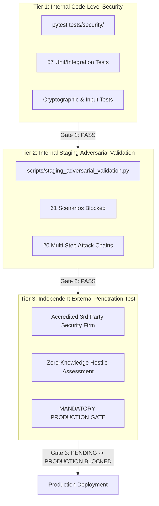

# Ra7al Application Security Release Gates & Deployment Governance Policy

**Project:** Ra7al University Bus Management System  
**Document ID:** SEC-GATES-2026-V1  
**Authority:** Security Architecture & DevSecOps Governance Board  
**Status:** ENFORCED  

---

## 1. Governance Principles & Strict Separation of Testing Tiers

In accordance with institutional information security policy, software releases are governed by hard, objective security gates. Under no circumstances may an internal test replace or satisfy an external audit requirement.

### Hard Definitions:
1. **INTERNAL AUTOMATED SECURITY TESTING:** Code-level unit, schema, and API route security checks executing within CI/CD (`pytest tests/security`).
2. **INTERNAL STAGING ADVERSARIAL VALIDATION:** Developer-led adversarial black-box simulations against staging containers evaluating state machines, IDOR matrices, rate limiting, and concurrency (`scripts/staging_adversarial_validation.py`).
3. **INDEPENDENT EXTERNAL PENETRATION TEST:** Formal, independent penetration test executed by an accredited, neutral third-party cybersecurity auditing company.

---

## 2. Security Release Gates Matrix

| Release Environment | Gate ID | Required Security Verifications | Gate Decision Rule | Current Status |
| :--- | :--- | :--- | :--- | :---: |
| **Development / PR** | **GATE-DEV** | * `pytest tests/unit` passes 100% * Linter & static analysis clean | Automatic merge block if failed | **PASS** |
| **Staging** | **GATE-STG** | * Full regression suite (`pytest`) passes (363+ tests) * Automated security tests (`pytest tests/security`) pass 57/57 * Dependency vulnerability scan (`pip-audit`) 0 CVEs * Internal Staging Adversarial Validation (61/61 blocked) * Database backup & recovery procedure verified | Required for staging deployment | **PASS** |
| **Production** | **GATE-PROD** | * All GATE-STG prerequisites satisfied * Production configuration hardening verified (`DEBUG=False`, secrets non-default, port isolation) * **Independent External Penetration Test COMPLETED & CERTIFIED with 0 Critical / 0 High open findings** | **STRICT HARD BLOCK** until external pentest sign-off | **BLOCKED (AMBER)** |

---

## 3. Production Security Gate Evaluation

$$\text{Production Gate Status} = \begin{cases} 
\textbf{GREEN} & \text{if } \text{GATE-STG} = \text{PASS} \land \text{ConfigAudit} = \text{PASS} \land \text{ExternalPentest} = \text{PASS} \\ 
\textbf{BLOCKED} & \text{if } \text{ExternalPentest} \in \{\text{NOT PERFORMED}, \text{FAIL}, \text{INCOMPLETE}\}
\end{cases}$$

### Current Gate Audit:
* **Internal Automated Security Testing:** **PASS** (57/57 passed)
* **Internal Staging Adversarial Validation:** **PASS** (61/61 passed, 20/20 attack chains blocked)
* **Dependency Security Audit:** **PASS** (0 CVEs via `pip-audit 2.10.1`)
* **Backup & Recovery Verification:** **PASS** (`pg_dump -Fc` / isolation verified)
* **Production Configuration Hardening:** **PASS** (`DEBUG=False`, strong secrets, Redis rate limiter)
* **Independent External Penetration Test:** **NOT PERFORMED**
* **PRODUCTION GATE DECISION:** **BLOCKED (AMBER)**

---

## 4. Production Release Gating Checklist

- [x] Full Pytest Regression Suite (363 passed, 3 skipped, 0 failed)
- [x] Security Test Suite (`pytest tests/security` - 57 passed, 0 failed)
- [x] Dependency Vulnerability Scan (`pip-audit` - 0 vulnerabilities found)
- [x] Staging Adversarial Validation (`scripts/staging_adversarial_validation.py` - 61/61 blocked)
- [x] Multi-Step Attack Chains (20/20 chains evaluated and blocked)
- [x] Concurrency & Race Condition Verification (10-thread QR scan race verified)
- [x] Private Storage Isolation & Magic Byte Upload Filtering
- [x] Runtime Sensitive Data Redaction Filter active
- [x] Database Backup Isolation & Restoration Verification
- [x] Production Docker Compose Port Isolation (DB 5432 and Redis 6379 hidden from host)
- [ ] **Independent External Penetration Test Contracted**
- [ ] **Independent External Penetration Test Executed**
- [ ] **External Vulnerability Remediation & Regression Tests Applied**
- [ ] **Third-Party Retest & Certified Security Sign-Off Received**
