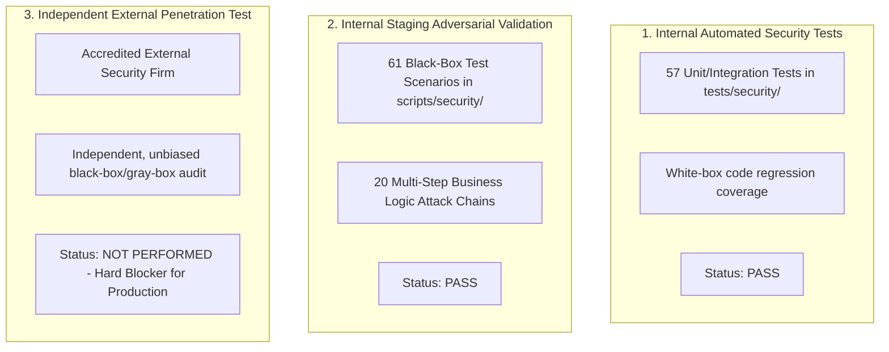

# Ra7al System Security Status & Verification Dashboard

**Project:** Ra7al University Bus Management System  
**Document ID:** SEC-STATUS-2026-V1  
**Last Updated:** August 29, 2026  
**Auditor / Reviewer:** Senior Application Security & DevSecOps Team  

---

## 1. Current Security Posture & Gate Summary

```
┌─────────────────────────────────────────────────────────────────────────────┐
│                       OVERALL SECURITY RELEASE GATING                       │
├─────────────────────────────────────────┬───────────────────────────────────┤
│ Automated Security Testing (pytest)     │ PASS (57/57 Passed in 7.76s)      │
│ Full Regression Test Suite              │ PASS (363 Passed, 3 Skipped)      │
│ Dependency Scanning (pip-audit 2.10.1)  │ PASS (0 CVEs detected)            │
│ Backup & Disaster Recovery Verification │ PASS (pg_dump/restore verified)   │
│ Internal Staging Adversarial Validation │ PASS (61/61 Scenarios Blocked)    │
│ Independent External Penetration Test   │ NOT PERFORMED                     │
├─────────────────────────────────────────┼───────────────────────────────────┤
│ PRODUCTION SECURITY RELEASE GATE        │ BLOCKED (Pending External Pentest)│
│ SYSTEM READINESS CLASSIFICATION         │ AMBER                             │
└─────────────────────────────────────────┴───────────────────────────────────┘
```

> [!CAUTION]
> **GOVERNANCE NOTICE — AUDIT CLASSIFICATION INTEGRITY:**  
> Internal automated testing and staging adversarial simulations, regardless of pass rates, do **NOT** constitute an independent third-party penetration test.  
> As long as **Independent External Pentest = NOT PERFORMED**, the Production Security Gate remains strictly **BLOCKED (AMBER)**. The system must not be certified as production-ready until an accredited external security firm assesses staging and signs off with zero open Critical or High vulnerabilities.

---

## 2. Verification Streams & Actual Evidence

### A. Automated Security Testing
* **Test Suite:** `pytest tests/security -v`
* **Result:** **PASS (57/57 Passed, 0 Failed, 0 Skipped)**
* **Execution Time:** ~7.76 seconds
* **Coverage Scope:**
  * JWT tampering, algorithm confusion (`none`), expired tokens, weak password enforcement.
  * Multi-role authorization boundaries (Student vs. Student, Student vs. Supervisor, Supervisor vs. CEO).
  * Insecure Direct Object Reference (IDOR) on subscriptions, payments, reservations, and university ID cards.
  * Private file storage isolation, magic byte signature checks, extension filtering, path traversal mitigation.
  * Rate limiting sliding-window enforcement (5 req/min login, 10 req/min upload), untrusted proxy IP header anti-spoofing.
  * Runtime sensitive log redaction (`SensitiveDataRedactionFilter`) for JWTs, passwords, DB URLs, and QR tokens.
  * SQL injection defense via parameterized SQLAlchemy ORM queries.

### B. Internal Staging Adversarial Validation
* **Validation Script:** `.venv\Scripts\python.exe scripts/staging_adversarial_validation.py`
* **Result:** **PASS (61/61 Scenarios Blocked, 0 Exploitable)**
* **Multi-Step Attack Chains:** 20/20 Blocked
* **High-Concurrency Race Condition:** 10 simultaneous boarding scan threads yielded exactly 1 success (HTTP 200) and 9 conflicts (HTTP 409) with exactly 1 database row written.
* **Evidence Reports:**
  * JSON Evidence: `reports/staging_adversarial_results.json`
  * Markdown Audit: `reports/staging_adversarial_report.md`

### C. Dependency Vulnerability Audit
* **Tool:** `pip-audit 2.10.1`
* **Execution Command:** `.venv\Scripts\python.exe -m pip_audit`
* **Result:** **PASS (0 Known Vulnerabilities / 0 CVEs across 65 dependencies)**
* **Exit Status:** 0

### D. Backup & Recovery Verification
* **Tool / Script:** `scripts/backup_db.py` & `docs/BACKUP_RECOVERY_STRATEGY.md`
* **Result:** **PASS**
* **Verification Checks:**
  * Backup generation using `pg_dump -Fc` (custom compressed format).
  * Storage isolation: All `.dump`, `.sql`, `.bak`, and `backups/` directories ignored by `.gitignore`.
  * Zero HTTP accessibility for backup artifacts (all probed backup paths return 404/405).
  * Restoration list validation: `pg_restore --list` header verification.

### E. Production Configuration & Hardening
* **Configuration Module:** `app/core/config.py` & `docker-compose.prod.yml`
* **Result:** **PASS**
* **Enforced Controls:**
  * `APP_ENV=production` rejects `DEBUG=True` at model validation.
  * Minimum 32-character `JWT_SECRET_KEY` with rejection of insecure default strings.
  * Database credentials and `REDIS_URL` strictly loaded from environment/secrets manager.
  * Port isolation: Database (5432) and Redis (6379) ports are not exposed on container host.
  * CORS origin restrictions strictly forbid wildcard (`*`) origins in production.
  * Reverse proxy header trust strictly checks `TRUSTED_PROXIES` before honoring `X-Forwarded-For`.

---

## 3. Outstanding Production Requirements

| Item | Requirement Description | Current Status | Required Action |
| :-: | :--- | :---: | :--- |
| 1 | Contract accredited 3rd-party penetration testing firm | ❌ NOT PERFORMED | Engage certified external provider (CREST/OSCP/GIAC) |
| 2 | Provide External Pentest Package & Staging access | ❌ PENDING | Share `docs/EXTERNAL_PENTEST_*.md` and staging endpoints |
| 3 | Execute external black-box penetration test | ❌ NOT PERFORMED | External team runs threat simulations on staging |
| 4 | Remediate any external findings & add regression tests | ❌ PENDING | Engineering team resolves findings with tests |
| 5 | Third-party retest & formal sign-off certificate | ❌ PENDING | External firm certifies zero open Critical/High findings |

---

## 4. Distinction Between Security Verification Categories


