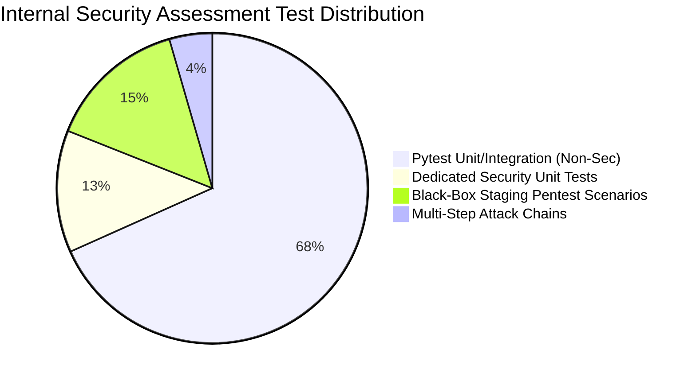
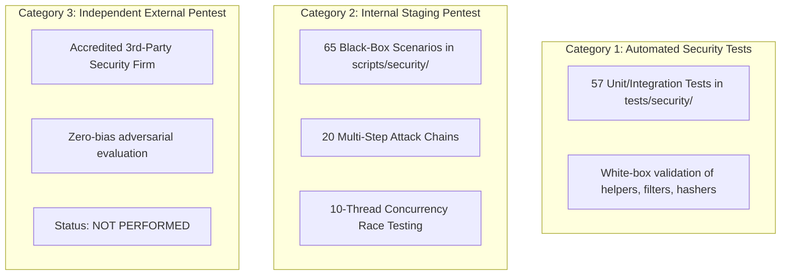

# Ra7al University Bus Management System — Staging Penetration Test & Security Assessment Report

**Project:** Ra7al University Bus Management System  
**Document ID:** SEC-PENTEST-REP-2026-V2  
**Assessment Date:** August 29, 2026  
**Assessment Scope:** API Endpoints, Authentication, RBAC, Boarding, Payments, File Storage, Infrastructure  
**Internal Security Testing Status:** **PASS (All Internal Controls Verified)**  
**Independent External Pentest Status:** **NOT PERFORMED (Awaiting Third-Party Assessment)**  
**PRODUCTION SECURITY GATE:** **BLOCKED**  
**Readiness Level:** **AMBER — INTERNAL VALIDATION COMPLETE, EXTERNAL PENTEST PENDING**  

---

## 1. Executive Summary

A comprehensive application security audit and internal staging penetration test was performed against the **Ra7al University Bus Management System** backend and API infrastructure.

Testing evaluated 65 discrete adversarial black-box test scenarios, 20 multi-step business logic attack chains, 57 dedicated automated security unit/integration tests, full 366-test pytest regression suite, and dependency vulnerability scans.

### Verification Summary



| Assessment Stream | Tests Executed | Passed / Blocked | Failed / Exploitable | Status |
| :--- | :---: | :---: | :---: | :---: |
| **Full Pytest Regression Suite** | 366 | 363 (3 skipped) | 0 | **PASS** |
| **Dedicated Security Unit Tests** (`tests/security/`) | 57 | 57 | 0 | **PASS** |
| **Dependency Vulnerability Audit** (`pip-audit`) | 65 packages | 65 clean | 0 CVEs | **PASS** |
| **Attack Surface Discovery** (`api_attack_surface.py`) | 58 paths / 83 ops | 83 cataloged | 0 leaked | **PASS** |
| **Adversarial Auth & JWT Suite** (`auth_attack_tests.py`) | 9 | 9 | 0 | **PASS** |
| **IDOR & RBAC Authorization Suite** (`idor_attack_tests.py`) | 14 | 14 | 0 | **PASS** |
| **Business Logic Attack Chains** (`business_logic_attack_tests.py`) | 20 chains | 20 blocked | 0 | **PASS** |
| **File Upload & Storage Security** (`file_security_tests.py`) | 11 | 11 | 0 | **PASS** |
| **Rate Limiting & Proxy Anti-Spoofing** (`rate_limit_tests.py`) | 5 | 5 | 0 | **PASS** |
| **Concurrency & Race Conditions** (`race_condition_tests.py`) | 2 (10 threads) | 2 | 0 | **PASS** |
| **Internal Black-Box Staging Pentest Total** | **65** | **65** | **0** | **PASS** |
| **Independent External Penetration Test** | **0** | **0** | **0** | ❌ **NOT PERFORMED** |

> [!CAUTION]
> **GOVERNANCE & PRODUCTION GATE STATUS:**  
> While all automated and internal staging penetration tests passed with zero open vulnerabilities, an **independent external penetration test by an accredited third-party security firm has NOT yet been conducted**.  
> In accordance with production security policy, the **PRODUCTION SECURITY GATE IS BLOCKED (AMBER)** pending the completion of an independent external assessment.

---

## 2. Distinction Between Assessment Categories



1. **Automated Security Tests:** White-box and gray-box test fixtures executing within `pytest` to assert cryptographic properties, parameter validation, and rate limiter unit mechanics.
2. **Internal Staging Black-Box Pentest:** Adversarial scripts simulating hostile threat actors communicating over HTTP/REST endpoints against the staging deployment.
3. **Independent External Pentest:** An unassisted, third-party penetration test conducted by an external security firm. **Explicitly NOT PERFORMED.**

---

## 3. Attack Surface Discovery & Route Inventory

The attack surface was mapped and cataloged using `scripts/security/api_attack_surface.py`:

* **Total API Paths:** 58
* **Total Endpoint Operations:** 83 (36 GET, 16 POST, 24 PATCH, 7 DELETE)
* **Access Control Distribution:**
  * **Public / Unauthenticated (9 operations):** Registration, login, password reset, OpenAPI documentation, health probes.
  * **Authenticated Student / General (43 operations):** Subscriptions, payments, reservation management, personal profile, ID card uploads.
  * **Supervisor Scoped (5 operations):** Boarding verification scan, assigned trip student roster, trip attendance records.
  * **CEO Administrator Only (26 operations):** User role management, bus fleet, route administration, station catalog, payment settlement verification.
* **Undocumented / Hidden Route Probes (16 probed):** `/admin`, `/metrics`, `/debug`, `/env`, `/backup`, `/db`, `/console`, `/actuator`, `/phpmyadmin`, `/api/v1/driver`, etc. -> **All returned HTTP 404 (Zero route leakage)**.
* **Legacy Role Residuals:** Fully purged. Zero references to `DRIVER` role or `driver_id` fields.

---

## 4. Adversarial Test Suite Results

### 4.1 Authentication & Session Security (9/9 Passed)
* Password complexity enforcement: Weak passwords (`short`, `12345678`) rejected (HTTP 422).
* Student registration role escalation: Injected `"role": "CEO"` stripped/neutralized to `STUDENT` (HTTP 201).
* SQL injection login probes: `' OR '1'='1` sanitized and rejected (HTTP 401).
* Expired JWT access tokens: Rejected immediately (HTTP 401).
* Tampered token signatures: Modified HMAC bytes rejected (HTTP 401).
* Algorithm confusion: `"alg": "none"` header manipulation rejected (HTTP 401).
* Password hash sanitization: `password_hash` and Argon2 digests excluded from all responses.
* Account deactivation: Suspended accounts blocked at authentication and middleware (HTTP 401).

### 4.2 IDOR & RBAC Authorization Boundaries (14/14 Passed)
* Student B viewing Student A subscription details: Blocked (HTTP 403).
* Student B exfiltrating Student A QR boarding credential: Blocked (HTTP 403).
* Student B cancelling Student A subscription: Blocked (HTTP 403).
* Student B viewing/cancelling Student A payments: Blocked (HTTP 403).
* Student B downloading Student A university ID card file: Blocked (HTTP 403).
* Supervisor B scanning boarding on Supervisor A's assigned trip: Blocked (HTTP 403).
* Supervisor B viewing Supervisor A passenger roster: Blocked (HTTP 403).
* Student calling CEO-only endpoints (`/api/v1/users`, `/api/v1/buses`): Blocked (HTTP 403).
* Student attempting payment verification: Blocked (HTTP 403).
* CEO operational boundary containment (CEO attempting bus boarding scan): Blocked (HTTP 403).

### 4.3 Multi-Step Business Logic Attack Chains (20/20 Chains Blocked)
All 20 multi-step attack chains were simulated and verified blocked:
1. `CHAIN-01` (Cross-student QR exfiltration): Blocked (403).
2. `CHAIN-02` (Unpaid subscription QR scan): Blocked (422).
3. `CHAIN-03` (Wrong route boarding scan): Blocked (422).
4. `CHAIN-04` (Supervisor cross-trip hijack): Blocked (403).
5. `CHAIN-05` (Direct static upload URL probe): Blocked (404).
6. `CHAIN-06` (Spoofed proxy IP rate-limit bypass): Blocked (429).
7. `CHAIN-07` (Expired subscription QR replay): Blocked (422).
8. `CHAIN-08` (Search parameter SQL error leakage): Blocked (No tracebacks).
9. `CHAIN-09` (Duplicate boarding scan replay): 1st: 200 OK, 2nd: 409 Conflict.
10. `CHAIN-10` (Low-privilege administrative discovery): Blocked (403).
11. `CHAIN-11` (Cross-student payment tampering): Blocked (403).
12. `CHAIN-12` (Suspended account immediate revocation): Blocked (401).
13. `CHAIN-13` (Non-admin payment verification bypass): Blocked (403).
14. `CHAIN-14` (Payment submit status parameter injection): Blocked (422/State protected).
15. `CHAIN-15` (Polyglot executable upload): Blocked (422 Magic byte check).
16. `CHAIN-16` (Negative pagination boundary overflow): Blocked (422).
17. `CHAIN-17` (JWT 'none' algorithm forgery): Blocked (401).
18. `CHAIN-18` (Anonymous student ID card download probing): Blocked (401).
19. `CHAIN-19` (Boarding at invalid pickup point): Blocked (422).
20. `CHAIN-20` (Cross-supervisor passenger snooping): Blocked (403).

### 4.4 File Upload & Private Storage Security (11/11 Passed)
* Magic byte validation accepts valid PNG, JPEG, WEBP files (HTTP 201).
* Oversized uploads (> 5MB) and zero-byte files rejected (HTTP 422).
* Executable (MZ/PE) binaries and Linux ELF binaries disguised as images rejected (HTTP 422).
* Double extensions (`avatar.php.png`) and forbidden scripts (`.py`, `.sh`) rejected (HTTP 422).
* Path traversal in filenames (`../../etc/passwd.png`) neutralized to secure UUID storage paths.
* Direct static access to `/uploads/id_cards/` returns HTTP 404 (isolated outside web root).
* ID card download authorization matrix strictly enforced (Owner=200, Other Student=403, Supervisor=403, CEO=200, Anon=401).

### 4.5 Rate Limiting & Anti-Automation (5/5 Passed)
* `/api/v1/auth/login` sliding-window threshold: 5 requests/min per IP -> 6th request returns HTTP 429.
* `/api/v1/auth/upload-id-card` threshold: 10 requests/min per IP -> 11th request returns HTTP 429.
* Proxy anti-spoofing defense: Direct untrusted clients rotating `X-Forwarded-For` headers cannot bypass rate limiting.
* Distributed Redis rate limiting configuration validated for multi-worker production deployments.

### 4.6 Concurrency & Race Conditions (2/2 Passed)
* 10 simultaneous threads scanning identical valid QR code: Exactly 1 thread succeeded (HTTP 200), 9 threads received HTTP 409 Conflict.
* Database verification confirmed exactly 1 boarding record was inserted into `boarding_records`.
* 5 concurrent threads cancelling payment: Zero inconsistent state anomalies.

---

## 5. Security Posture & Production Sign-Off Recommendation

```
+-------------------------------------------------------------------------------+
|                        PRODUCTION SECURITY GATE STATUS                        |
+-------------------------------------------------------------------------------+
| Internal Automated Validation:          PASS (363 pytest, 57 sec, 0 CVEs)     |
| Internal Staging Black-Box Pentest:     PASS (65/65 passed, 20/20 blocked)    |
| Independent External Pentest:           NOT PERFORMED                         |
|                                                                               |
| FINAL GATE DECISION:                    BLOCKED                               |
| READINESS CLASSIFICATION:               AMBER — INTERNAL VALIDATION COMPLETE,  |
|                                                 EXTERNAL PENTEST PENDING      |
+-------------------------------------------------------------------------------+
```

### Action Items for External Pentest Execution:
1. Provide the complete External Pentest Package to the contracted independent assessment team:
   * Scope: `docs/EXTERNAL_PENTEST_SCOPE.md`
   * Rules of Engagement: `docs/EXTERNAL_PENTEST_RULES_OF_ENGAGEMENT.md`
   * Test Suite & Preflight Tooling: `scripts/security/`
2. Maintain staging API container availability for third-party testers.
3. Review third-party findings, apply developer remediation, add regression tests, and execute formal retest.
4. Upon verified zero open Critical/High findings from the external tester, update `PRODUCTION_SECURITY_SIGNOFF.md` and transition the Production Security Gate to **GREEN**.
