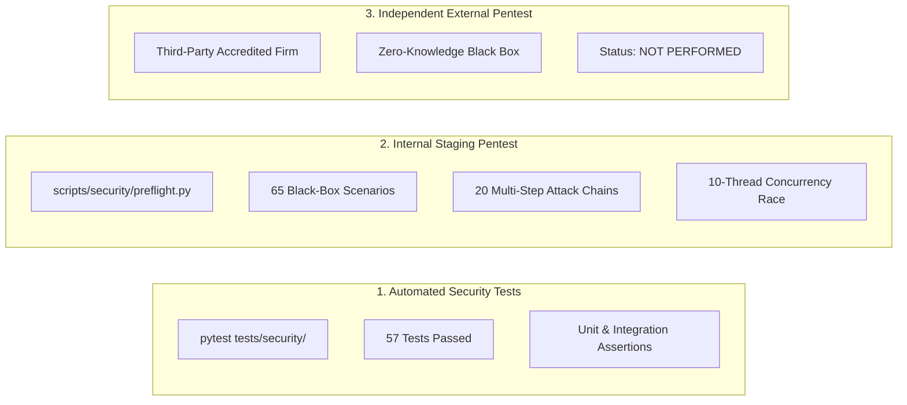
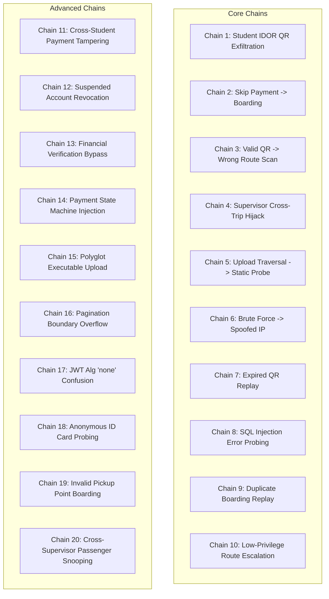

# Ra7al Staging Penetration Testing Plan & External Readiness Framework

**Project:** Ra7al University Bus Management System  
**Document ID:** SEC-PENTEST-PLAN-2026-V2  
**Target Environment:** Staging Container & API Infrastructure (`https://staging-api.ra7al.edu` / `http://localhost:8000`)  
**Assessment Standard:** OWASP Top 10 API Security (2023), OWASP ASVS v4.0.3, NIST SP 800-115  
**Internal Staging Pentest Status:** **COMPLETED (65/65 Scenarios Passed, 20/20 Attack Chains Blocked)**  
**Independent External Pentest Status:** **NOT PERFORMED (Pending Third-Party Audit)**  
**Production Readiness:** **AMBER — INTERNAL VALIDATION COMPLETE, EXTERNAL PENTEST PENDING**  

---

## 1. Executive Overview & Scope

This penetration testing plan defines the structured adversarial testing methodology, threat model, persona matrix, multi-step attack chains, input fuzzing, rate-limiting evaluations, file security checks, and concurrency race validations for the **Ra7al University Bus Management System**.

The backend manages critical university transit operations:
* Student Personally Identifiable Information (PII), academic year, faculty, and national/student ID card document scans.
* Financial settlement transactions via Vodafone Cash, InstaPay, and cash collection.
* Cryptographic QR token generation and validation for bus boarding access.
* Role-based access control across Students, Supervisors, and CEO administrators.

---

## 2. Distinction of Security Validation Categories

To ensure absolute audit integrity, security validations are partitioned into three non-overlapping categories:



1. **Automated Security Tests:** 57 automated unit and integration tests under `tests/security/` verifying individual cryptographic and validation components.
2. **Internal Staging Black-Box Pentest:** 65 adversarial test scenarios executing 20 multi-step attack chains, rate-limit spoofing, IDOR matrices, and high-concurrency race conditions.
3. **Independent External Penetration Test:** A genuine third-party assessment conducted by external accredited security engineers. **NOT PERFORMED.**

---

## 3. Threat Model & Adversary Personas

The threat model assumes adversaries operating from the public internet with varying levels of privilege:

| Persona | Attacker Description | Staging Test Account | Primary Objective |
| :--- | :--- | :--- | :--- |
| **Anonymous Attacker** | Unauthenticated public threat actor | *None (No Bearer Token)* | Route enumeration, credential stuffing, static asset scraping, unauthenticated PII exfiltration |
| **Student A** | Legitimate student on Route 1 | `student_a@ra7al.edu.eg` | Normal student operations, baseline for horizontal IDOR attacks |
| **Student B** | Hostile student on Route 2 | `student_b@ra7al.edu.eg` | Attempt IDOR against Student A (steal QR, view ID card, cancel payments), role escalation |
| **Supervisor Alpha** | Transit supervisor on Trip 1 | `supervisor_a@ra7al.edu.eg` | Operational passenger boarding scans and attendance rosters for Trip 1 |
| **Supervisor Beta** | Transit supervisor on Trip 2 | `supervisor_b@ra7al.edu.eg` | Attempt cross-trip hijacking on Trip 1, access other supervisor rosters, financial tampering |
| **CEO Administrator** | Executive administrator | `ceo@ra7al.edu.eg` | System-wide management; evaluate operational containment (blocked from bus scanning) |
| **Suspended Student** | Deactivated student account | `disabled_student@ra7al.edu.eg` | Verify immediate session and token revocation upon account suspension |

---

## 4. Multi-Step Attack Chains (20 Chains Evaluated)

The test plan evaluates 20 end-to-end multi-step attack chains:



| Chain ID | Attack Scenario & Methodology | Expected Result | Internal Status |
| :--- | :--- | :--- | :---: |
| **CHAIN-01** | Student B manipulates subscription ID to download Student A's QR boarding pass | HTTP 403 Forbidden | **BLOCKED** |
| **CHAIN-02** | Student initiates subscription, skips payment verification, attempts QR scan | HTTP 422 Unprocessable Entity | **BLOCKED** |
| **CHAIN-03** | Student uses valid Route 1 QR token to board Route 2 bus trip | HTTP 422 Route Mismatch | **BLOCKED** |
| **CHAIN-04** | Supervisor B modifies scan payload to record attendance on Supervisor A's trip | HTTP 403 Forbidden | **BLOCKED** |
| **CHAIN-05** | Attacker uploads student ID card and attempts direct HTTP access at `/uploads/id_cards/*` | HTTP 404 Not Found | **BLOCKED** |
| **CHAIN-06** | Credential stuffing attacker rotates spoofed `X-Forwarded-For` proxy headers | Throttled with HTTP 429 | **BLOCKED** |
| **CHAIN-07** | Student presents cached QR token from expired subscription to board bus | HTTP 422 Subscription Expired | **BLOCKED** |
| **CHAIN-08** | Attacker injects SQL payloads into search queries to induce error disclosure | Sanitized JSON Response | **BLOCKED** |
| **CHAIN-09** | Valid QR token scanned for outbound trip, then immediately re-scanned | 1st: 200 OK, 2nd: 409 Conflict | **BLOCKED** |
| **CHAIN-10** | Student token used to access `/api/v1/users` or modify user roles | HTTP 403 Forbidden | **BLOCKED** |
| **CHAIN-11** | Student B attempts to cancel Student A's active payment record | HTTP 403 Forbidden | **BLOCKED** |
| **CHAIN-12** | Suspended student attempts login, profile retrieval, and boarding | HTTP 401 Unauthorized | **BLOCKED** |
| **CHAIN-13** | Non-admin user attempts direct payment verification at `/payments/{id}/verify` | HTTP 403 Forbidden | **BLOCKED** |
| **CHAIN-14** | Student attempts self-approval by injecting `"status": "VERIFIED"` into submit payload | Server ignores injected status | **BLOCKED** |
| **CHAIN-15** | Polyglot PHP shell disguised with `.png` extension and spoofed MIME header | HTTP 422 Magic Byte Mismatch | **BLOCKED** |
| **CHAIN-16** | Negative pagination and boundary overflow (`page=-5`, `page_size=99999999`) | HTTP 422 Validation Error | **BLOCKED** |
| **CHAIN-17** | Token forged with `"alg": "none"` and stripped signature submitted to API | HTTP 401 Unauthorized | **BLOCKED** |
| **CHAIN-18** | Anonymous attacker probes `/api/v1/users/{id}/id-card` to download private scans | HTTP 401 Unauthorized | **BLOCKED** |
| **CHAIN-19** | Passenger attempts to board using valid QR at non-existent pickup point | HTTP 422 Invalid Pickup Point | **BLOCKED** |
| **CHAIN-20** | Supervisor B queries passenger manifest and attendance history of Supervisor A trip | HTTP 403 Forbidden | **BLOCKED** |

---

## 5. Automated Preflight Tooling Suite

All test scenarios are codified into reproducible tools under `scripts/security/`:

```bash
# 1. Complete Preflight Runner
python scripts/security/external_pentest_preflight.py

# 2. Attack Surface Discovery & Route Probing
python scripts/security/api_attack_surface.py

# 3. Authentication & JWT Security Tests
python scripts/security/auth_attack_tests.py

# 4. IDOR & Authorization Boundary Tests
python scripts/security/idor_attack_tests.py

# 5. Multi-Step Business Logic Attack Chains
python scripts/security/business_logic_attack_tests.py

# 6. File Upload & Storage Security Tests
python scripts/security/file_security_tests.py

# 7. Rate Limiting & Proxy Spoofing Tests
python scripts/security/rate_limit_tests.py

# 8. Concurrency & High-Thread Race Condition Tests
python scripts/security/race_condition_tests.py
```

---

## 6. Independent External Pentest Next Steps

To close the remaining production gap:
1. Provide the **External Pentest Package** (`docs/EXTERNAL_PENTEST_SCOPE.md`, `docs/EXTERNAL_PENTEST_RULES_OF_ENGAGEMENT.md`, and `scripts/security/`) to an accredited external security testing firm.
2. Maintain staging container availability during testing.
3. Remediate any discovered external findings, add regression test coverage, and obtain a formal retest certificate.
